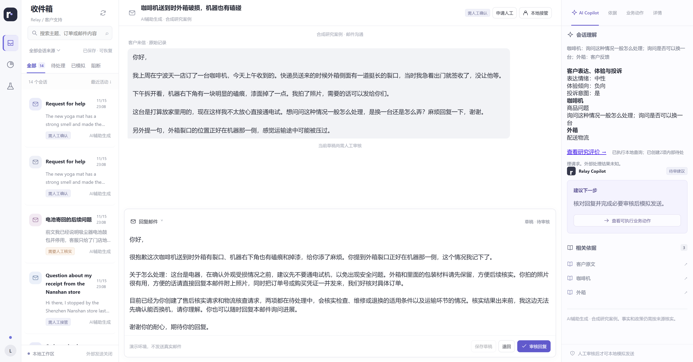
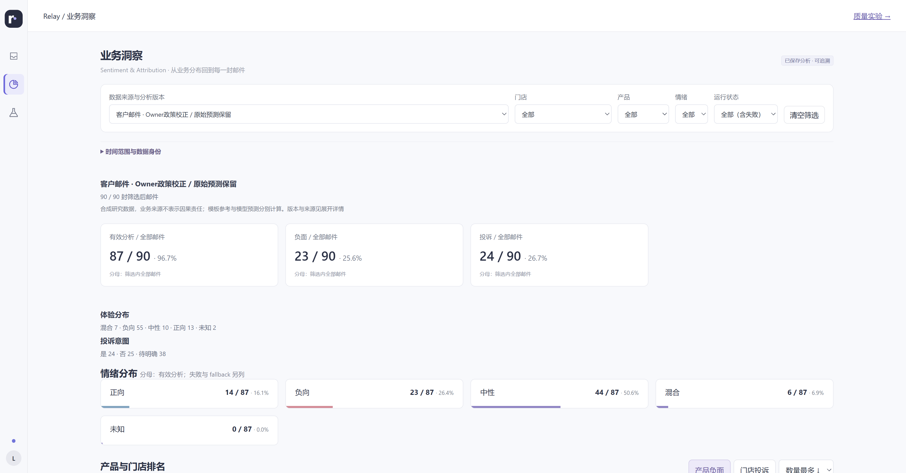
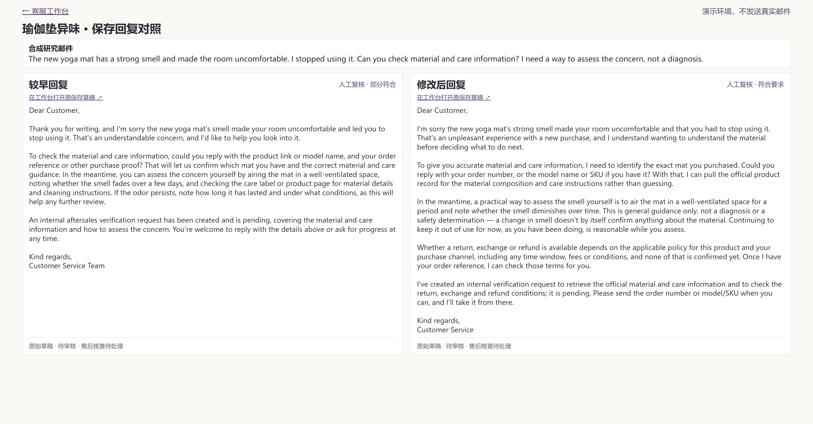

# Customer Complaint Intelligence

**从客户来信到有依据的服务回应。** 基于 React、FastAPI、LangChain 和 DeepSeek 的客户反馈分析与回复审核应用。

系统分别识别客户的表达情绪、实际体验和投诉意图，将一封邮件中的多个问题关联到商品、门店及原文证据。客服可以查看反馈趋势、核查业务事项、编辑回复，并在人工审核后进行本地模拟发送。



## 按用户任务了解产品

| 用户任务 | 产品能力 | 入口 |
| --- | --- | --- |
| 找到来信 | 会话搜索、状态筛选、原信与对应草稿 | 客服工作台 |
| 理解反馈 | 表达情绪、体验倾向、投诉意图、多问题事项和逐字原文引用 | AI Copilot、依据 |
| 查看趋势 | 商品负面体验、门店服务投诉、商品与门店交叉筛选、成员下钻 | 业务洞察 |
| 跟进诉求 | 产品资料查询、售后、物流、账单及门店事项分别记录 | 业务动作 |
| 审核回复 | 编辑保存、退回意见、版本记录、风险阻断和审批条件 | 回复区、详情 |
| 检查质量 | 历史分类对照、回复评价和保存版本对比 | 质量评价 |

门店被提及与门店被投诉分别统计。业务计数由 Python 确定性计算，保留分子、分母和原邮件成员，支持回查分析依据。



## 快速启动

使用 **Python 3.12、Node.js 22 和 npm**。首次安装需要访问软件包仓库，运行演示无需 API 密钥。

也可以下载 Release 中的完整工程 ZIP，解压进入项目目录，从下方 `python -m venv .venv` 开始执行。

```powershell
git clone https://github.com/BillZhao626/customer-complaint-intelligence.git
cd customer-complaint-intelligence
python -m venv .venv
.\.venv\Scripts\python.exe -m pip install -r requirements.lock.txt
cd web-client
npm ci
npm run build
cd ..
.\.venv\Scripts\python.exe -B review.py
```

macOS/Linux 使用 `.venv/bin/python` 替代上述 Python 路径。打开 **http://127.0.0.1:8790/**，按 Ctrl+C 停止。端口可通过 `python review.py --port 8791` 调整。

演示读取仓库中经过筛选的合成邮件和历史保存输出，在临时 SQLite 数据库中运行真实 API、业务逻辑和 React 界面。编辑与审核保留在本次会话，退出后临时数据库清除。启动入口强制关闭模型调用和遥测，没有 SMTP、退款或外部订单写入。无需复制 `.env`，也不依赖原开发机数据库。

### 建议体验顺序

1. 打开 [瑜伽垫来信](http://127.0.0.1:8790/portfolio/cases/yoga-later)，切换 AI Copilot、依据、业务动作和详情。
2. 打开 [业务洞察](http://127.0.0.1:8790/?view=insights&source=b8-r6-policy)，按商品与门店筛选，再点击统计成员回看邮件。
3. 查看 [商品到货磕碰](http://127.0.0.1:8790/portfolio/cases/p12) 的售后与物流两条独立事项。
4. 在 [表扬邮件](http://127.0.0.1:8790/portfolio/cases/p10) 中修改一处草稿并保存，在详情回看对应版本；通过审核后才能本地模拟发送。
5. 搜索 `synced copy`，查看事实未确认时的审批限制。打开 [保存回复对照](http://127.0.0.1:8790/portfolio/yoga)，比较两份原始回复及其人工评价。



## LangChain 怎样参与实际链路


LangChain 的 `ChatOpenAI` 客户端组织消息并调用 DeepSeek；回复阶段使用 `bind(tools=...).ainvoke(...)` 约束工具参数输出。应用层解析 JSON、验证原文引用和任务身份，再把核查结果与实际事项状态带入回复。业务工具由 Python 执行，结构化输出工具本身不代表执行了退款或物流操作。

运行记录支持回看实际保存的分析、回复和事件。完整源码同时保留模型 provider、预算与请求控制、工具执行、事实检查、自动评价和工作流。离线演示复用这些应用模块，回放保存结果；它不会重新生成模型答案。

详细的调用职责、数据关系及持久化迁移见 [架构与源码导航](docs/ARCHITECTURE.md)。

## 工程特征

- **多问题及来源关联。** 同一邮件可以同时包含表扬、商品问题与配送诉求，每项保留对应原句。
- **事实与动作分开。** 资料未知时保持核查状态，回复中涉及“已创建”的动作须有匹配回执。
- **版本与审批绑定。** 保存修改产生新版本，历史审批不能直接用于修改后的草稿；旧页面写入受到版本冲突检查。
- **风险审核。** 安全、凭据和未知同步行为等问题进入明确复核路径，前后端共同执行批准条件。
- **可追溯统计。** 统计成员可以回到原邮件和分析版本，失败、未知及不同分母保持区分。
- **默认离线验证。** 自动测试阻断外部连接，使用临时存储和显式 fixture。

## 评价结果与复核

| 评价对象 | 保存结果 | 解释 |
| --- | --- | --- |
| 历史情绪分类 | 78/80，Macro-F1 0.9712 | 与项目历史参考标签对照；不是独立人工泛化准确率 |
| 同组 54 封合成研究邮件 | 47/54 → 51/54 → 52/54 | 同一自动评价标准下三种保存方案的初步通过数 |
| 预设严重问题 | 11/11 检出，正常对照误报 0/29 | 受控开发案例上的评价检查 |
| 人工判断对照 | 15/17 一致 | 对应精确保存版本的人工定性评价 |
| 重复与换位 | 18/20、17/19 一致 | 分别检验重复评分与调换顺序后的稳定性 |

上述为历史保存结果，当前方案仍有 2/54 未达到初步通过标准，不能解释为全量人工认证或真实业务解决率。瑜伽垫案例的后续回复更具体地回应使用不适，补齐退换与退款核查方向，并依据订单和购买渠道核实适用条件。两份原始回复与人工评价绑定，编辑后的新稿不继承旧评价。

样本来源与指标定义见 [合成样本说明](examples/README.md)。本轮工程验收见 [验证说明](docs/VALIDATION.md)。

## 验证工程

```powershell
.\.venv\Scripts\python.exe -m pip check
.\.venv\Scripts\python.exe -B tests/run_offline.py
.\.venv\Scripts\python.exe -B verify_review.py
cd web-client
npm test
npm run build
```

测试、构建与 CI 的成功属于工程验证，保存模型结果的质量结论按上表的样本和评价范围理解。需要受控模型实验时，先阅读 [模型调用与研究复现](docs/MODEL_EXECUTION.md)，不要将历史实验脚本当作普通测试入口。

## 源码布局

| 位置 | 内容 |
| --- | --- |
| `web-client/` | React / TypeScript 工作台、业务洞察、评价页面及前端测试 |
| `src/app/` | FastAPI 路由、会话、防跨源访问及请求校验 |
| `src/application/` | 分析编排、证据关联、工具规划、事项状态、审核及版本 |
| `src/infrastructure/` | LangChain provider、请求控制、SQLite 存储和可移植数据路径 |
| `src/domain/`、`src/schemas/` | 邮件、分析、问题事项及版本契约 |
| `src/evaluation/`、`tests/` | 分类与回复评价、风险检查、离线回归 |
| `src/dataset/`、`configs/` | 合成数据构建、校验、统计和配置模板 |
| `examples/`、`resources/` | 审查后的合成样本、保存输出、明确的离线 fixture |
| `review.py` | 临时数据库启动及保存案例回放入口 |
| `app.py` | 保留的早期 Streamlit 研究入口 |

公开范围与排除项见 [源码与资产范围](docs/PUBLIC_SCOPE.md)。自有源码采用 [MIT](LICENSE)，第三方组件保持各自许可，见 [第三方与数据说明](THIRD_PARTY_NOTICES.md)。

## 版本关系

早期 Streamlit 原型保留在 Git 历史中，可查看 [原 main 快照](https://github.com/BillZhao626/customer-complaint-intelligence/tree/f0a5eb71e7a46c036700f1d406cc3b34b680ff07)。本次完整工程候选承接该历史，新增当前 React / FastAPI 应用与可复核样本，不重写旧提交。

当前候选的发布状态、提交和实测记录见 [发布说明](docs/RELEASE.md)。
