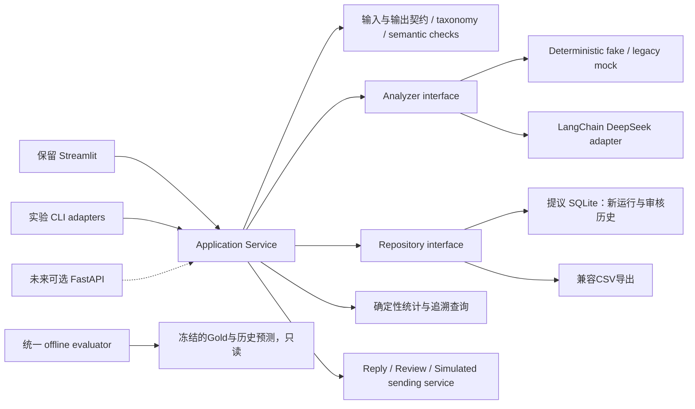

# Architecture Options：渐进恢复与目标架构

## ADR-P1：方案 A 已接受并实施（2026-10-15）

本轮用户明确批准模块化 Python 单体与 SQLite 新运行试点。实际链路为 `app.py → src/app/offline_slice.py → AnalysisService → Analyzer Protocol / OfflineFake → Repository → SQLite`，服务不 import Streamlit。legacy mock 是独立规则后端；未来 DeepSeek 接入边界保留，但当前新服务不允许网络 backend。其余下文是 P0 候选方案记录，不是新增实施授权。

采用 analysis-v2、research-products-v2，单邮件/主要问题/业务来源语义，unknown 与 Service/Other 分离。共享评测核心不改历史 Gold；SQLite 仅四张必要表，原文、版本、attempt、raw/normalized 与成功幂等键同事务保存。接口不依赖 HTTP，未来可由 API 调用，但未引入 FastAPI/React/队列/多 Agent/RAG。

决定依据：修复 F01–F06 后完成真实 Single Analysis AppTest 纵切片；详见 [契约](../p1/CONTRACT_SPEC.md)、[存储](../p1/SQLITE_STORAGE.md)、[验证](../p1/VERIFICATION.md)。SQLite 并发唯一性只做小规模离线验证，不声称生产多用户适用。硬中断尝试恢复、provider deadline/usage、独立 holdout 和完整审核发送留待后续授权。

---

批次 2026-10-14；完成于 2026-10-15（Asia/Shanghai）。状态：**PROPOSED，未冻结、未实施**。

依据：[源码审计](../audit/2026-10-14-legacy-audit.md)、[离线证据](../audit/evidence/2026-10-14/offline-verification.json)。当前 Streamlit 确实可运行；核心问题是两套契约、评测缺陷、可变CSV和版本追溯，而非已证实的前端技术瓶颈。

## 1. 选择标准与推荐

推荐**A：保留 Streamlit，提取模块化 Python 核心；经人工确认后以 SQLite 支撑单机可追溯纵切片**。服务边界按将来可被 FastAPI 调用设计，但第一阶段不实现 HTTP API。先让业务流程和指标可信，再决定是否增加部署复杂度。

这是设计建议，不是本轮获得的新实现授权。当前没有并发用户数、API调用方、远程部署、任务时长SLO或团队前后端分工数据，不能据此冻结 B/C 或声称 SQLite 已证明足够生产负载。

| 候选 | 解决的问题与仓库证据 | 实施复杂度/风险 | 毕设与产品收益 | 选择条件 |
|---|---|---|---|---|
| A：Streamlit + 模块化核心 | app混合IO/分析/展示；UI与CLI不同Schema，适合service和adapter收敛 | 低到中；需保持旧演示、CSV和历史结果兼容，避免界面行为一次改变太多 | 最快形成真实UI→应用逻辑→存储→追溯，论文可解释，测试成本较低 | **推荐当前采用**；单机MVP优先 |
| B：FastAPI + 同一模块化核心 + Streamlit客户端 | 明确的多客户端API、服务独立部署、权限边界/任务查询需求；当前尚未证实 | 中；增加序列化/网络错误/认证/进程部署/集成测试；同步HTTP本身不解决长任务 | API契约可复用，未来React迁移更平滑 | 至少存在第二调用方或明确远程多用户部署要求，再以ADR批准 |
| C：B + 按需任务/持久化/流程编排 | 需后台断点恢复、跨进程worker、长时间审批或较高写并发；当前只有CLI批次 | 中到高；选组件分别论证，不视为一套必选套餐 | 达到相应负载和工作流需求后有收益 | 用实际负载/恢复测试证明A或B不足；不默认LangGraph+Redis+Celery全部引入 |

不推荐当前直接改 React+TypeScript、微服务或全量 LangGraph：已发现缺陷都可以在 Python 核心中修复。前端重写会延后研究闭环，无法自动解决 Gold、schema、指标分母或模型版本问题。

## 2. 建议的目标边界

Application Service 是普通 Python 接口，不能只把原 `app.py` 拆成多个依旧相互依赖 Streamlit 的文件。纯业务模块不 import `streamlit`；UI持有展示状态，service拥有调用/错误/存储策略，provider只做模型适配，repository只管数据约束与查询。UI不再自行推导 backend、成功或分母。

### 2.1 候选目录（P1确认后按纵切片建立，不提前铺空目录）

| 候选模块 | 责任 | 当前迁移起点 |
|---|---|---|
| `src/domain/contracts.py` / `taxonomy.py` | EmailInput、AnalysisResult、错误/运行状态和schema版本；canonical ID与alias规则 | 两个Pydantic模型和链内Literal |
| `src/application/analysis_service.py` | 校验输入、选择后端、创建run/attempt、保存结果与返回DTO | app单条/批量和CLI调用 |
| `src/infrastructure/llm/` | DeepSeek适配、Prompt渲染、严格解析、provider telemetry | 现有LangChain链；不先更换provider包 |
| `src/infrastructure/storage/` | Repository、SQLite实现、临时测试数据库、CSV适配 | 固定CSV读写 |
| `src/application/attribution_service.py` | 固定过滤口径、分母、成员ID、run版本；不让LLM算总量 | 两套dashboard builder |
| `src/evaluation/` 的共享核心 | ID对齐、coverage、七字段raw指标及单独normalized视图 | UI evaluator和I4E2纯函数；CLI保留兼容wrapper |
| `src/application/reply_service.py` / `review_service.py` | 草稿版本、事实检查、人工审核及模拟发送 | 目前只有suggested_reply |
| `tests/` | Unit/Contract/Integration/离线UI回归 | 当前资产验证器继续保留，但不充当全部测试 |

这些名称是建议，允许P1根据最小改动调整。不要把所有论文阶段脚本同时迁移；先做adapter，使历史runner能保留旧输出协议。

## 3. 数据与接口契约：需要先决定的内容

全部为 PROPOSED；以下是设计讨论需要的具体边界，不是当前数据库结构。

| 对象 | 最小字段/约束 | 意义 |
|---|---|---|
| Email | internal_id、source、external_id、subject/body、content_hash、import_batch_id、created_at | 同一外部ID内容变化可检测；原文不被预测覆盖；真实PII权限另定 |
| AnalysisRun | run_id、email_id、input_hash、backend、requested/resolved_model、prompt/schema/taxonomy版本及hash、code/dependency标识、status、timestamps | 可判断历史结果与当前配置是否一致；没有resolved_model时明确缺失 |
| AnalysisAttempt | run_id、attempt_no、类别化error、elapsed、parse/validation状态、usage/finish_reason/request_id若可用 | SDK与应用重试统一预算；成本未知不得记0 |
| AnalysisResult | run_id、canonical字段、raw输出或受控保留引用、normalized输出、validation_errors、证据片段 | 原始输出与清洗输出分离；合法JSON不代表语义正确 |
| Review / Correction | analysis_version、操作者、before/after、reason、审核状态、时间 | 不覆盖模型预测或Gold；并发修改有version check |
| ReplyDraft | draft_id、analysis_version、事实引用、文本、风险检查结果、版本 | 审核之后若内容改变须重新审核 |
| SimulatedSend | approved_draft_version、idempotency_key、simulated状态、审计事件 | 只模拟；不设计真实SMTP为默认能力 |
| AggregateQuery / Result | run集合/版本、filters、numerator、denominator、unknown_count、member_ids | 任一统计都可下钻原文和结果；排除failed/fallback的口径显式 |

原文追溯可在本地保存；真实数据后续需明确最小保留、访问控制和日志脱敏。内容hash是完整性/去重辅助，不等于匿名化或通用隐私解决方案。

### 3.1 Taxonomy 与业务语义

推荐 canonical category 向当前400数据的八类研究口径对齐，并设计 `unknown/Other` 的明确政策；这是**待人工确认**的语义决定。旧LLM的 Beauty Products/Sportswear/Service 与 Food缺失问题必须由版本化adapter处理，不能原地修改Gold然后宣布指标提升。

同样需决定：未知门店与渠道是否拆字段、是否允许不确定情绪、单主问题的优先级、未来多问题是否独立 issue 子对象。第一纵切片保留单主问题，记录语义限制；多标签迁移单独决策，防止计数分母从邮件变成问题却不说明。

新评测器必须先校验双方ID与必需字段，再join；不允许缺字段时比较同一列，不允许重复ID静默dict覆盖，不允许缩到交集而隐藏coverage。raw指标与normalized指标分别命名和保存；summary/reply不计入现有七字段准确率，另建人工rubric。

### 3.2 可靠性与幂等

建议幂等键包含 input_hash + backend/model配置 + prompt/schema/taxonomy版本；同键重复操作重用已成功结果，不同版本创建新run。失败尝试独立保留，fallback标成fallback而非真实模型成功。后台任务初期可同步调用加明确进度/失败状态；若需刷新后继续，再实现持久任务状态，不能靠 session_state 作为任务队列。

网络重试分为限流/短暂服务错误/超时和不可重试认证/输入错误；JSON修复重试另计，但所有尝试共享预算。显式deadline、总调用数和用户取消策略比单独增加retries更重要。未决定具体数值前先用fake验证边界；真实超时/并发阈值需授权实验测定。

SQLite提议使用事务、外键、唯一键和可重复初始化；只写新运行文件，历史CSV作为只读导入源。历史导入必须标记 `historical_import`，绝不生成伪attempt/request log。不要把过去80/400条标记成新模型调用。

## 4. 技术逐项取舍

| 技术 | 建议 | 真实依据/解决问题 | 复杂度、风险与替代 |
|---|---|---|---|
| LangChain | 保留、渐进收敛 | 已有LCEL和Runnable；适配器隔离Prompt/模型方便fake | 低到中；避免为新抽象改写有效链。替代为直接SDK，但暂无足够收益 |
| DeepSeek | 保留可插拔provider | 已有80/400历史预测；当前语义与实际可用性未重测 | 先contract+telemetry；模型alias会变化。替代其他provider须独立授权和冻结实验 |
| Pydantic | 保留并统一契约 | 两套模型及空JSON通过问题已复现 | 中；严格校验可能增加显式失败，需legacy adapter与版本说明；不是“去掉验证” |
| Streamlit | 保留MVP、拆业务耦合 | AppTest启动/单条/模式已跑通；4个tab已有研究展示价值 | 低到中；状态/文件上传需测试。复杂审核体验成为明确痛点后再换前端 |
| FastAPI | 暂不引入，保留边界 | 当前无第二API客户端/远程服务硬需求 | 中；只有多客户端/部署隔离需求时收益明确。替代普通Python service |
| React + TypeScript | 推迟 | 当前瓶颈是契约与证据，不是JS能力 | 高；重建图表/上传/审核及部署。未来基于批准的API协议渐进替换页面 |
| SQLite | 推荐下一阶段小范围试点，待确认 | 固定CSV无法支持运行版本/审核/追溯，单机毕设适合验证 | 中；不声称满足未知并发。替代先append-only run目录，但约束/查询较弱 |
| PostgreSQL | 推迟 | 暂无多主机/多写入者/生产权限需求 | 中到高；增加运维和迁移。SQLite并发测试失败且有明确部署要求后评估 |
| LangGraph | 暂不引入 | 目前是线性分析；人工审核尚未实现，无复杂checkpoint图 | 中到高；先显式状态机+持久事件。长暂停/分支恢复真正复杂时做小PoC |
| LangSmith | 本轮不使用，后续可选 | 缺trace确实存在，但不能因此外传邮件或使用付费服务 | 本地结构化日志可先补版本/usage；若启用须用户明确数据与费用授权 |
| Redis | 暂不引入 | 无已证实跨进程缓存/队列协调需求 | 增加服务和一致性负担；替代进程内限流+数据库状态 |
| Celery | 暂不引入 | I4G已有CLI检查点，尚无Web后台worker刚需 | 中到高；broker/worker/部署/重复投递问题需独立论证；必要时先小型持久worker |
| RAG/向量数据库/MCP/多Agent/微服务 | 不做 | 当前任务不依赖检索知识库或分布式自治 | 无明确研究或交付收益；若回复政策未来需知识检索，再单独论证 |

JSON模式并不承诺语义正确，且第三方OpenAI兼容接口特性可能不同，依据 [DeepSeek JSON说明](https://api-docs.deepseek.com/guides/json_mode/) 与 [ChatOpenAI文档](https://docs.langchain.com/oss/python/integrations/chat/openai)。本轮没有为了“规范”擅自替换已验证provider包或升级依赖。

## 5. 迁移顺序、保护与回退

1. 冻结原始资产hash，明确Gold角色，先补能揭露F01–F06的离线回归；不要先动Prompt再解释指标。
2. 审定canonical契约，给legacy mock/LLM建立adapter；保留旧80预测和旧评测公式的复核入口。
3. 从Single Analysis接入普通Python service和repository；用fake走保存/刷新/详情/统计追溯。保存新run，不覆盖`outputs/`历史文件。
4. 接入真实模型adapter的严格验证、deadline、attempt日志；单独授权小额真实评测，再接批次恢复。
5. 收敛Dashboard和评测核心、补审核/模拟发送。B/C只有需求门槛满足后再开ADR。

每一步以离线测试和旧演示可用为门槛。回退到兼容wrapper或旧UI入口应保留新run的导出能力；不得通过删除新数据、改Gold或重写Git历史实现回退。增加数据库后另写可逆迁移计划，本轮没有创建数据库或执行迁移。

## 6. Human Review：需要决定而非重复确认的事项

| 决策 | 推荐方向 | 影响/缺少证据 |
|---|---|---|
| 架构方向 | A + 普通应用服务；SQLite小范围新运行试点 | 属于后续架构实施授权，本轮只提出方案；若有远程多用户要求需补充 |
| 分类与未知值 | 八类研究口径 + 明确unknown策略 + legacy adapter | 决定新Schema、指标和历史映射，不能自动改Gold |
| Source Attribution语义 | 保留单主业务来源，禁止因果/法律责任表达 | 多问题如何计数待需求明确 |
| 合成数据研究要求 | 保留模板基线；若论文要求LLM生成，另建有provenance的LLM数据版本 | 现有400未证明LLM生成；涉及模型预算与标注 |
| 可信评测 | 原80作为历史/回归，新增独立冻结holdout并保存review记录 | 标注者与预算尚无授权，不能补造历史 |
| 真实模型和外部服务 | 后续明确模型、样本、最大调用/费用、数据范围 | 本轮没有调用或上传；不能把“继续审计”当作付费授权 |

这些决定可用于下一轮Implementation Prompt；当前方案仍为PROPOSED。具体分阶段门槛见 [PHASED_ROADMAP](../plans/PHASED_ROADMAP.md)。
