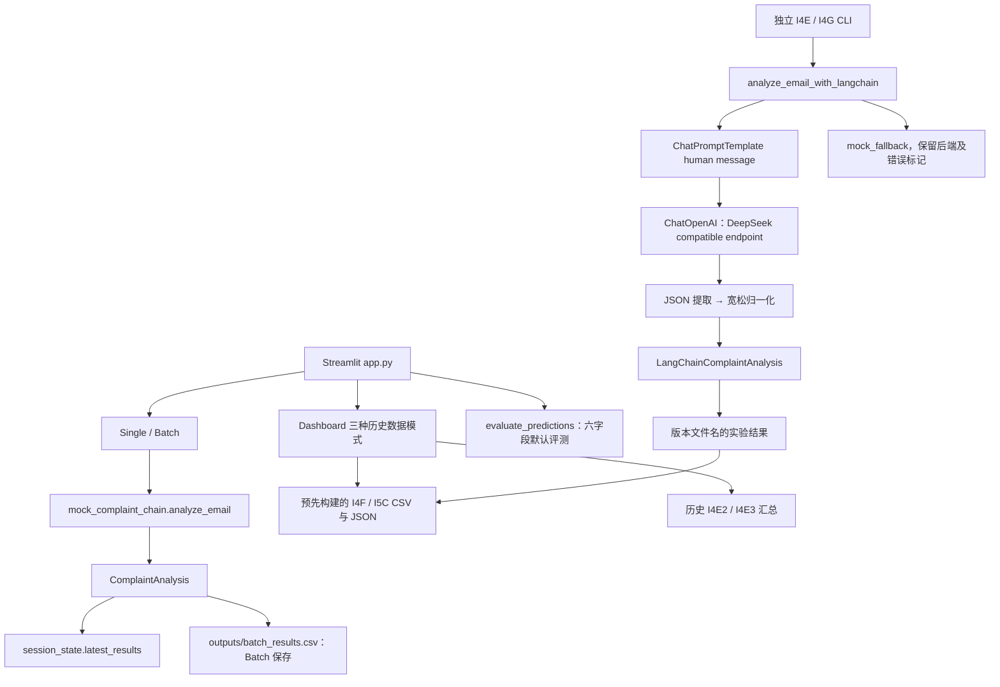

# Legacy Audit：实际状态与架构恢复

## P1 更新（2026-10-15）

本文件下方保留 P0 审计时点事实；其中“未修改”“PROPOSED”和旧行号只描述 P0。P1 已按用户批准的方案 A 实施，验收状态与证据以 [P1 验证记录](../p1/VERIFICATION.md) 为准。

| 缺陷 | P1 状态与证据 |
|---|---|
| F01 | 修复：共享核心分别验证双方字段/空值；tests/test_regressions.py 与 test_evaluation.py |
| F02 | 修复：重复/空 ID 拒绝，80/79 和 extra 返回 invalid，无分数；正式 wrapper 不再 dict 覆盖 |
| F03 | 修复：legacy provider 在默认值/normalization 前严格验证；v2 分离 parse/contract/normalization/business；空对象/数组/bool/类型回归 |
| F04 | 修复：独立 research-products-v2 完整八类 + unknown；旧四个歧义枚举不猜测；旧 raw 494/560 不变 |
| F05 | 修复：正式报告缺失/坏 JSON/不可读/校验失败均 unavailable；AppTest 证据，不回退硬编码成绩 |
| F06 | 修复：逐行 backend/flags/status/error、失败数、唯一 ID、固定输入 ID 校验；399+1 不 accepted，旧400仍可复核 |
| F07 | 新单条 SQLite、新 UI 导出/示例独立路径已隔离；旧历史 CLI 固定输出入口仍保留，P1 未运行，不是新运行推荐路径 |
| F08 | 研究限制保留：旧80不是新盲测；未修改 Gold、未补造人工或 API 历史 |

后续 F09–F14 仍按 P2–P6 范围处理；本轮补了单条持久化/rerun 与确定性最小下钻，不代表完整生产系统或全部产品闭环完成。

---

审计批次：2026-10-14。完成日期：2026-10-15（Asia/Shanghai；跨日完成，文件名保留用户指定日期）。

状态：**AUDIT_PARTIAL**。授权范围内的源码检查、离线复算、隔离验证与设计交付已完成；当前真实 API、独立人工标注过程、完整浏览器 E2E 和论文页面视觉质量仍未验证。PARTIAL 不代表检查被单个测试阻断，也不代表应立即调用模型补齐。

## 1. 证据规则与保护边界

| 标记 | 含义 |
|---|---|
| CODE_FACT | 本轮读取的源码、配置、资产或 Git 状态直接支持 |
| RUN_VERIFIED | 本轮执行了离线复算、行为探针或无网络模拟验证 |
| HISTORICAL_ONLY | 历史记录声明的事件；本轮只核查其留存资产 |
| INFERRED | 从明确证据推导，尚非直接运行事实 |
| UNVERIFIED | 现有材料或授权不足，不能确认 |
| PROPOSED | 未来方案，未实施或冻结 |

所有路径相对仓库根目录 `D:\Projects\complaint_llm_system`；行号对应本轮未修改的源码。详细函数行号见 [source-inventory.json](evidence/2026-10-14/source-inventory.json)。审计工具放在 `docs/audit/tools/`，不是新增业务模块。

起始资产清单包含 401 个文件，12,733,023 字节；排除 `.git`、`.venv`、`__pycache__`，包含 `.env` 的文件摘要但不输出其内容。原始 SHA-256 清单见 [baseline-manifest.json](evidence/2026-10-14/baseline-manifest.json)。运行环境为现有 `.venv`，没有安装、升级或锁定依赖。

初次隔离目录：`D:\TEMP\complaint_legacy_audit_20261014_fxoke_gy`。副本不含 `.env`；子进程强制禁用 API 和 tracing，审计钩子阻止网络连接及隔离目录外的写入。资产验证脚本会写报告、部分会执行 `py_compile`，因此全部在副本执行。模板重建仅调用内存中的 `generate_records()`，未重写原始数据。临时副本保留用于复核，没有清理既有文件。

## 2. Git、依赖与工程环境

### 2.1 仓库真实状态

- CODE_FACT：分支 `main`，**无任何提交**。`git rev-parse HEAD` 无法解析，`git log` 报告无提交，`git rev-list --all --count` 为 0；不能给出真实 HEAD SHA。
- CODE_FACT：`git ls-files` 为 0；起始有 400 个未跟踪文件，另有被忽略的 `.env`。这不是一个可以通过 `git diff` 保护历史成果的已提交仓库。
- CODE_FACT：根目录及适用父目录未发现 `AGENTS.md`，未发现 `HANDOFF.md`；`.agents/`、`.codex/` 为空。新建简洁规则和交接文档，不覆盖历史文件。
- CODE_FACT：未发现锁文件、`pyproject.toml`、自动化 CI、Docker 构建或标准 `tests/` 目录。README 是累计阶段记录，部分描述和当前实现并存，不能作为唯一功能证据。
- RUN_VERIFIED：`.gitignore` 正确忽略 `.env`、虚拟环境、Python 缓存和 `.streamlit/secrets.toml`，保留 `.env.example`。没有执行 commit、push、reset、tag 或 release。

### 2.2 实际版本

| 项目 | 本轮本地版本 |
|---|---|
| Python | 3.12.8；README 推荐 3.11，未另外验证 3.11 |
| Streamlit | 1.57.0 |
| LangChain / langchain-core / langchain-openai | 1.3.1 / 1.4.0 / 1.2.1 |
| Pydantic / pandas | 2.13.4 / 3.0.3 |
| scikit-learn / Plotly | 1.8.0 / 6.7.0 |
| OpenAI SDK / httpx | 2.37.0 / 0.28.1 |

RUN_VERIFIED：`python -B -m pip check` 输出 `No broken requirements found.`。这证明安装依赖的声明兼容，不能证明产品功能正确。

CODE_FACT：`requirements.txt` 的八个直接依赖均仅有 `>=` 下界，例如 `langchain>=0.2.0`，没有上界或完整解析版本。旧版本需求与本地 1.x 环境跨度大，复现性风险明确；本轮不把“无锁”误报成“本地必然不能运行”，也不未经验证断言某库过时。

CODE_FACT：`.env.example` 默认 `LLM_ENABLE_API=false`；实际本地 `.env` 已启用 API 且存在非空 key。仅核查键名和布尔状态，没有打印 key、base URL 等实际私有配置。`get_llm_config()` 在每次调用时通过自写 dotenv 读取文件并 `os.environ.setdefault`，随后浮点/整数转换。错误数字配置可能在 `_langchain_llm_analysis()` 主异常捕获之前抛出；配置缺少范围、URL 和模型兼容校验。

RUN_VERIFIED：对可读源码/文档/CSV/JSON 扫描，本地 key 未出现在 `.env` 之外，未发现长 `sk-` token 形式的字面量。此扫描不等于全面秘密检测，未扫描虚拟环境、Git 对象或图像中的文字。两个最大的资产是 2.02 MB 和 2.36 MB DOCX；目前不构成明显大文件阻断，但后续开源前仍需检查论文图片、个人信息、版权与许可。没有发现 LICENSE。

## 3. As-Is：实际能力与调用关系



### 3.1 能力清单（以源码和运行结果为准）

| 能力 | 真实入口与核心函数 | 状态与边界 |
|---|---|---|
| 单条分析与回复建议 | `app.py:403` → mock `analyze_email:398` | RUN_VERIFIED：AppTest 点击可运行；没有调用 DeepSeek，没有审核/发送 |
| CSV 批处理 | `app.py:429` → `run_batch_analysis:100` → `save_results:123` | CODE_FACT + RUN_VERIFIED：5 条函数级保存/重读；真实上传控件和下载未做浏览器验证 |
| 文本列识别 | `app.py:70` / `detect_text_column:92` | 支持 email_body 等；候选中含所有列，用户仍可选非文本列 |
| 当前结果浏览 | `get_active_results:111` / Dashboard | 单条存 session；批量写共享固定 CSV。没有运行版本/用户隔离 |
| Dashboard 三模式 | `render_i4f_dashboard:248` | RUN_VERIFIED：合成参考、DeepSeek 历史预测、正式评测模式均可无异常执行；不是即时 LLM 聚合 |
| 正式七字段指标 | `run_i4e2_reviewed_80_eval_v1.compute_weighted_metrics:110` | RUN_VERIFIED：历史预测与 Gold 可离线复算；与 UI 默认六字段评测不是同一实现 |
| DeepSeek 分析 | `langchain_complaint_chain.py:525` | CODE_FACT，fake provider 路径 RUN_VERIFIED；真实模型本轮 UNVERIFIED |
| 400 条 CLI 批量实验 | `run_i4g_full_pool_deepseek_batch_v1.py:253` | 存在逐条进度、结果检查点、按 ID 恢复和失败 CSV；没有 UI 调用该流程 |
| 数据生成 | `generate_full_dataset_v1.generate_records:374` | RUN_VERIFIED：400 行与确定性模板生成结果完全一致；不存在已验证的 LLM 自动生成链路 |
| 标注/论文材料 | `data/golden/`、`docs/dissertation/`、`outputs/review_batches_i4c/` | 资产存在并检查关键内容；不等于独立盲标、论文已最终审定 |

未发现独立 application service、数据库、账号/租户、审核记录、邮件发送器、模拟发送状态机、后台任务调度或 React/FastAPI 应用。不要把长期产品流程写成已实现功能。

### 3.2 模块责任、耦合和副作用

- `app.py` 570 行，同时包含路径、读写、调用、统计、指标默认值和 UI。`main()` 的四个 tab 内容会在每次 rerun 执行；没有缓存读取历史表。直接修改分析后端很容易影响页面状态与 CSV 契约。
- `src/chains/mock_complaint_chain.py` 规则基线：关键词情绪/紧急程度，正则产品/门店，模板摘要/回复，启发式 confidence。规则并不处理完整自然语言否定、多问题或中文理解；例如类别中有 Food，LLM 类别集没有 Food/Beverage。保留作为可复现基线，不宜表述为模型能力。
- `src/schemas/complaint_schema.py:12` 和链内 `LangChainComplaintAnalysis:48` 是两套模型。mock 模型没有 `source_attribution`、backend、parse/schema/API 元数据，类别/原因为自由字符串；LLM 模型内嵌更窄的 Literal 集。
- `src/config/llm_config.py` 在显式获取配置时读取 `.env`，不是 import 时调用模型。AST 顶层检查发现 `app.py:41` 建目录和 `st.set_page_config`，mock `:444` 创建 Runnable；相关核心模块未发现 import 即付费调用。没有把所有实验模块动态 import 执行，不能据此证明任何未来模块均无副作用。
- `src/dataset/` 同时承担模板生成、选择样本、写入 reviewed Gold 和 Dashboard 聚合；`src/evaluation/` 混合模型运行、指标、错误分析、标签候选修改和论文资产验证。多数写操作有 main guard，但运行入口并不都有防覆盖机制。

## 4. LangChain / LLM 链路细节

CODE_FACT：CLI 的 `prediction_text()` 把 subject 与 email_body 合并为 `Subject: ...\n\n...`；UI 批量仅传所选文本列。二者输入上下文不一致；未来接入同一模型时需显式统一或版本化，不能悄悄补 subject 改变历史实验条件。

1. `get_llm_config()` 决定是否启用 provider；禁用或缺 key 时返回 mock fallback。
2. `_invoke_llm_json:392` 从源码常量 `CUSTOMER_EMAIL_ANALYSIS_PROMPT:75` 构建 `ChatPromptTemplate.from_template`，实际是一个 human message；没有 separate system/untrusted-email message，也没有从 Pydantic 自动注入字段 Schema 或完整 JSON 示例。
3. `prompt | llm` 是实际 LCEL 组合；`ChatOpenAI` 通过 OpenAI 兼容 URL 调用 DeepSeek，传 temperature、max_tokens 和 `response_format=json_object`。没有 Agent、retriever、RAG、LangGraph 或 LangSmith 集成代码。
4. `_extract_json_object:175` 可剥离 markdown fence、裁剪首尾大括号并 `json.loads`；并不保证返回 dict，例如 `[]` 会返回 list。
5. `_prepare_llm_payload:323` 在 Pydantic 前补字段、映射未知枚举、转换 bool 和 clamp confidence；因此最终 schema success 是**修正后的对象通过模型**，不是原始模型输出完整遵约。
6. `_langchain_llm_analysis:417` 对 JSONDecodeError / ValidationError 追加严格 JSON 提醒再调用一次，失败返回 mock。API 类异常由外层捕获，交给 SDK 内部重试；AttributeError（如 JSON array 后 `.get`）不会走 JSON 修复重试。

RUN_VERIFIED：fake provider 注入无效 JSON 后 `{}`，发生 2 次本地 Runnable 调用，retry=1，最终返回 deepseek_api 标记且 schema_success=true；这验证重试控制流，不是 2 次真实 API。注入 TimeoutError 后返回 mock_fallback，parse/schema=false，错误标记可见。实际现有 `ChatOpenAI` 实例 request_timeout=None、SDK timeout=None、SDK max_retries=2；项目未显式设超时/重试总预算，不能把 `api_retry_count` 当作完整 HTTP 尝试次数。

CODE_FACT：提示词包含“不编造信息、不保证退款、业务来源不是法律责任”等约束，但没有确定性事实检查、回复政策规则、人工审核门禁。客户邮件内的恶意指令与任务要求处于同一消息；不执行工具降低了行动面，但仍可能污染结构化字段与草稿。当前没有输入长度上限、PII 脱敏、拒答/注入检测或证据片段坐标。真实客户数据不宜直接照搬当前实验路径。

CODE_FACT：key 遮罩覆盖配置 key 和 `sk-` 字符串，错误截断 800 字符，响应预览截断 300 字符；不等于对客户身份、订单或邮件正文脱敏。response 的 usage、finish_reason、实际返回模型标识/请求 ID 没有持久化。

官方文档核对（只读浏览，无用户数据上传）：[DeepSeek JSON Output](https://api-docs.deepseek.com/guides/json_mode/) 描述 JSON 格式输出、长度和空响应注意事项，不能据此推断字段语义正确。[LangChain ChatOpenAI](https://docs.langchain.com/oss/python/integrations/chat/openai) 提供 timeout/max_retries 配置，并提示 provider 特性兼容边界。优先保留已跑通适配器，新增 contract 测试后再评估 `langchain-deepseek`，不在本轮更换。

另据本轮访问的 [DeepSeek 模型说明](https://api-docs.deepseek.com/quick_start/pricing/)，旧 `deepseek-v4-flash` 名称仍可接受，但当前请求映射至后继 Flash 版本。历史 CSV 中相同 model_name 字符串不足以固定模型权重；这不否认历史预测存在，也不能证明今日同名重跑可复现。账户实际可用性本轮未调用验证。

## 5. 数据、Source Attribution 与追溯

### 5.1 资产关系

详见 [csv-inventory.json](evidence/2026-10-14/csv-inventory.json)：69 个 CSV，包含 24 个数据 CSV 与 45 个 outputs CSV。某些 review CSV 是一行一个字段问题，重复 email_id 合理，不能把所有 CSV 都强制按邮件唯一。

| 资产 | 行数/用途 | 关系与限制 |
|---|---|---|
| `data/synthetic/customer_emails_full_v1.csv` | 400 合成邮件 | email_id、subject、email_body、模拟客户、门店、产品、预期标签、scenario/edge_case/template ID |
| `data/golden/golden_labels_full_auto_v1.csv` | 400 auto labels | 与 full ID 一一对应；由模板预期标签产生，不是人工 Gold |
| `customer_emails_review_sample_v1.csv` / `golden_labels_review_sample_auto_v1.csv` | 各 80 | 从 full 覆盖性选择，非独立随机真实样本 |
| `golden_labels_review_sample_v1_reviewed.csv` | 80 reviewed | accepted=70、corrected=10；修改全部为 urgency；review_source=manual_review_chatgpt_assisted_v1 |
| `golden_labels_review_sample_manual_template_v1.csv` | 80 模板 | 所有 review_status 仍为 needs_review，不能当作完成的逐条签审记录 |
| `outputs/i4e2_reviewed_80_predictions_v1.csv` | 80 历史预测 | 七字段正式历史复算依据，含后端/模型/parse/schema/retry 标记 |
| `outputs/i4g_full_pool_deepseek_predictions_v1.csv` | 400 历史预测 | 与 full ID 完全一致；供 I5C 聚合；不是 400 人工标注准确率 |
| `outputs/dashboard_i4f/` / `dashboard_i5c_deepseek/` | 参考/预测聚合 | 两种来源不能混用；20 条 demo case 保留 ID，不是完整下钻接口 |
| `data/synthetic/customer_emails_pilot_v1.csv` | 50 pilot | created_by 全为 deterministic_template_generator_v1；用于开发和 Prompt 比较 |

RUN_VERIFIED：full 的 400 个 ID 唯一、与 labels/predictions 对齐，精确及大小写/空白归一化正文重复数均为 0。10 个门店各 40 条，8 个类别各 50 条，55 个 generation_template_id；无重复全文不代表语义独立或模板多样性充分。模板函数可完全重建现有 400 行，**“400 条由 LLM 实时生成”没有证据，且与现有生成路径不符**。

CODE_FACT + RUN_VERIFIED：reviewed Gold 由 `create_i4d_reviewed_golden_test_set_v1.py:93` 从 auto labels 加硬编码 `CORRECTIONS` 构建，10 处 urgency 与留存结果吻合。文件证明项目接受了这些参考标签；没有独立标注者身份、时间、双人盲标、一致性指标或完整原始人工决定记录，故“80 条均经独立人工复核”的强主张为 UNVERIFIED。不要未经授权重新标注来补齐。

### 5.2 归因到底实现了什么

- CODE_FACT：产品/门店识别是自由文本抽取/分类；LLM source_attribution 是单一主要业务来源枚举，mock 原模型没有此字段，fallback 才按 reason 映射。
- RUN_VERIFIED：I4F/I5C 都使用确定性 Python 分组计数，没有让 LLM 计算数据集总量。两套各 7 张表（门店、产品、矩阵和四个分布），共 14 张离线复算一致。
- 门店 complaint_rate = 同门店 is_complaint=true 数 / 同门店全部邮件数；negative_rate 分子为同门店 negative。产品维度同理。分母包含 positive/neutral，不是仅投诉，也不是门店客流/销量。
- reason/source/sentiment/urgency 分布的 count 与 percentage 以各自 400 行总量为分母，包含 `none`。展示“投诉原因分布”时应注明该口径，或另加仅投诉视图；不能悄悄换历史分母。
- CODE_FACT：矩阵记录 store×product 的 email/complaint/negative 计数；UI 读取排名而未展示完整矩阵或点击任意统计查看成员 ID。
- INFERRED：现在可由 source 文件和 ID 手工重算/追溯原邮件，但聚合行不存 run_id、成员 ID、过滤器或版本，不能声称已有完整业务追溯 UI。
- 不存在因果验证。source_attribution、reason 都是对客户陈述的业务分类，不能解释为已证实根因、法律责任或真实市场经营结论。

### 5.3 持久化缺口

现有 CSV 和若干版本文件名支持人工保留结果、离线复算；不支持可靠的 email→analysis run→人工修改→审核→发送状态历史。没有数据库事务、外键、唯一运行键或原文内容 hash 绑定。单条只在 session；批量覆盖 `outputs/batch_results.csv`，多会话共享；页面也没有保留上传的完整原文资产。

I4G 有每行检查点、成功行恢复、失败名单，不能笼统说“无断点续跑”。但恢复只看 email_id 和成功标记，不校验输入、Prompt、Schema、模型版本；写 CSV/JSON 不是原子事务，多个文件可能不一致；每行重写全量文件成本随批次增长。版本化文件名不能阻止重跑覆盖同名历史文件。I4E2 的预测与报告也会覆盖固定文件名。

门店仍为自由文本、城市和渠道可能混在同一字段，没有 canonical ID/alias 表；多门店/多产品/多问题会压成一个主要归属。当前数据未发现缺 ID 或重复邮件全文，但导入没有相应约束，不能推广为系统会拒绝坏数据。

## 6. 历史指标复核与可信度

### 6.1 可复算结论

| 声明 | 本轮结论 | 证据等级 |
|---|---|---|
| 400 条合成邮件 | 400 行，唯一 ID，模板重建一致 | RUN_VERIFIED |
| 80 reviewed 参考标签 | 文件存在；70 accepted、10 urgency corrected；独立标注过程不足 | CODE_FACT；人工过程 UNVERIFIED |
| 560 字段中 494 正确 | 按项目七字段参考规则逐项匹配，66 mismatch | RUN_VERIFIED |
| 88.21% | 494/560=88.2142857%；不是邮件全对率 | RUN_VERIFIED |
| 七字段全对邮件数 | 本轮新增离线统计：32/80=40%；仅限这七字段，不含摘要/回复/产品名 | RUN_VERIFIED |
| 400/400 API 成功，0 parse/schema 失败 | 400 行历史标记与汇总一致，失败 CSV 为 0；不代表本轮调用、不能独立证明 HTTP 事件 | RUN_VERIFIED 资产一致性；API 事件 HISTORICAL_ONLY |
| 80/80 API 成功 | 留存预测标记一致；未重跑 | 同上 |
| 归一化后 92.14% | 离线 516/560；类别 62/80=77.50%；事后解释视图，不替换原始 88.21% | RUN_VERIFIED |

| 字段 | 正确/80 | 准确率 | mismatch |
|---|---:|---:|---:|
| sentiment | 78 | 97.50% | 2 |
| urgency | 72 | 90.00% | 8 |
| is_complaint | 79 | 98.75% | 1 |
| store_location | 80 | 100.00% | 0 |
| product_category | 40 | 50.00% | 40 |
| complaint_reason | 75 | 93.75% | 5 |
| source_attribution | 70 | 87.50% | 10 |

RUN_VERIFIED：原七字段脚本计算的 accuracy、weighted precision/recall/F1、support、mismatch 全部与保存 JSON 在 1e-10 容差内一致，并另用独立逐值比较确认计数。缺字段评测器漏洞没有推翻这份完整、唯一、ID 对齐的 80 条七字段复算。

RUN_VERIFIED：reviewed 80 中各有 10 条 Food/Beverage、Service/Other、Beauty/Personal Care、Sports/Outdoor，合计 40 条类别无法由当前 LLM Literal 精确表示。这与 40 个类别 mismatch 一致。50% 类别准确率不能全部解释成模型理解差；是已证实的契约不兼容。改 canonical taxonomy 及指标映射必须保留旧标签与 raw 指标，另开版本。

### 6.2 可复现性的限度与泄漏核查

- 80 条与 smoke20 重合 20 条；正式结果包含已经用于 smoke 检查的样本。该集合并非未接触 holdout。
- 50 条 pilot 有 Prompt 补丁对比、错误分析和标签候选修订记录，可确认用于开发。80 条有后续 mismatch 分析和 I4E4 按同批数据设计的归一化解释，之后不能再把它视为未来 Prompt 优化的独立测试集。
- 未发现可以证明当前 Prompt 曾直接依据这 80 条调参的完整时间线，也没有 Git 历史可排除此事。结论为 UNVERIFIED，不能断言已经泄漏或绝对无泄漏。
- CODE_FACT：I4E/I4G的 `prediction_text()` 只拼接subject/body，没有把CSV里的`expected_*`或Gold字段直接拼入Prompt。这排除了该入口的显式标签字段注入，不能排除模板相似、开发复用或事后规则选择造成的污染。
- 原模板、Gold 和预测均来自内部合成分布；初始 `generate_sample_dataset.py:67` 直接用待测 mock 生成 `golden_labels.csv`，只可做自一致性演示，不可作为独立准确率证据。
- I4E2/I4G 的所谓 raw CSV 与解析后预测字节完全相同；写函数保存的是同一份结构化结果，不是原始模型完整响应。没有留存完整成功响应、请求 ID、usage、finish_reason、模型实际版本或每次尝试日志。
- I4G 汇总有历史总时长 2515.43 秒；不能作为本轮延迟，不能据此得到 p50/p95、每次尝试延迟、吞吐并发或成本。恢复时 runtime 还会只测本次循环而保留过去成功行。Token/成本没有可信记录。
- 配置文件与论文材料有部分 SHA-256、阶段名和模型名，但没有每次 run 同时绑定 input/prompt/schema/taxonomy/code/dependency hash。模型名本身还可能指向变化的 provider alias。

## 7. 缺陷与技术债登记

优先级：P1=进入下一阶段前优先修复/决策；P2=近期可靠性或维护问题；P3=需求出现再增强。下列均未在本轮修改业务实现。

| ID / 优先级 / 类型 | 证据、复现与影响 | 后续修复及验收 |
|---|---|---|
| F01 / P1 / 代码缺陷 | `evaluate_results.py:95` merge 后 `:115` 字段 fallback：预测缺 sentiment、Gold 有时，比较同一列得 1.0；反向缺 Gold 也成立。探针 RUN_VERIFIED | merge 前分别检查双方字段，缺失明确拒绝/跳过且不计分；加入正反缺字段回归 |
| F02 / P1 / 评测缺陷 | `evaluate_predictions:80` inner join 无唯一性/覆盖检查：2×2 同 ID 得 4 行；2 Gold/1 pred 只报 1 行无警告。正式脚本 `compute_weighted_metrics:110` 用 dict 会静默覆盖重复 ID | 唯一 ID、空 ID、missing/extra、matched/expected/coverage 明确；不得静默缩分母 |
| F03 / P1 / 契约缺陷 | LLM `_prepare_llm_payload:323` 接受 `{}`，默认 neutral/low/false、confidence=.8、空 reply，parse/schema 都 true；未知非空 bool→true，extra 被丢弃 | 原始响应严格 validation 与允许的 normalization 分开记录；空对象/缺字段/非法 bool/数组必失败 |
| F04 / P1 / 契约缺陷 | Gold 的四类与 LLM Literal 不兼容，40/80 无法精确输出；mock schema 也不同 | P1 审定 canonical taxonomy 与 legacy adapter；版本化，保留历史 raw score |
| F05 / P1 / 代码缺陷 | `app.py:192` / `:310`：两份正式汇总缺失仍显示 80、560、494、88.21%；AppTest 实际复现 | 缺失/校验失败展示 unavailable；指标完全来自验证过的报告；去除硬编码成绩/成功 caption |
| F06 / P1 / 代码缺陷 | I4G `summarize:150` acceptance 只要求众数 backend=deepseek；构造 399 deepseek+1 mock 且标记 true 时 accepted=true、failed_count=1 | acceptance 要求每行 backend/flags 一致、failed_count=0、ID/输入版本对齐；真实历史400行全deepseek未受此构造影响 |
| F07 / P1 / 数据保护风险 | UI `save_results:123` 和 `generate_sample_files:51` 固定覆盖 CSV/示例 Gold；CLI 固定版本名重跑也会覆盖 | 新 run 目录/存储、拒绝覆盖冻结资产；示例与 Gold 管理分离；并发隔离测试 |
| F08 / P1 / 研究可信度 | reviewed 文件有 assisted 来源和改动，但 manual 模板仍全 needs_review，缺盲标签审；80 已做 smoke/事后分析 | 现有结果按项目参考实验报告；新增独立盲审 holdout、标注记录与冻结 hash；不改旧80补造历史 |
| F09 / P2 / 可靠性 | 无显式 timeout/总预算、SDK重试不可计入 api_retry_count；配置数字错误在保护外；成功后丢 usage/finish_reason | 注入配置/provider；明确 deadline 和重试分类；各尝试日志、版本元数据、Token缺失标记 |
| F10 / P2 / 业务校验 | false complaint + product reason/source 可通过，历史80中有1条；单一主问题和未知值默认策略未业务冻结 | cross-field validators、uncertain/unknown 策略及主问题选择；需要人工审定语义 |
| F11 / P2 / Web 状态 | 单条/批量结果控件仅在 button 分支显示，rerun 消失；session 保存部分结果但无持久原文；CSV 为空/坏编码未统一处理，缺正文变成字符串也可分析 | service输入契约、空值拒绝、稳定结果视图；上传/错误/重跑/刷新测试 |
| F12 / P2 / 隐私与回复风险 | 同一 human prompt 混入客户指令，无事实证据绑定；PII及政策校验缺；回复承诺仅Prompt限制 | 不可信输入分隔、脱敏、回复事实/政策检查、人工审核；安全错误DTO |
| F13 / P2 / 可维护性 | app耦合IO/分析/展示；六/七字段指标实现分叉；两套Schema/两套聚合近重复；无锁/CI/run manifest | 小步提取应用服务与统一指标核心，兼容适配器、依赖快照与最小离线CI；保留基线 |
| F14 / P3 / 可选增强 | 多标签、别名门店、真实浏览器自动化、任务队列等尚未支持 | 由新需求驱动，不能因此默认全栈重写 |

## 8. 本轮执行结果与测试覆盖

### 8.1 已执行

完整记录：[validator-results.json](evidence/2026-10-14/validator-results.json)、[offline-verification.json](evidence/2026-10-14/offline-verification.json)、[additional-verification.json](evidence/2026-10-14/additional-verification.json)。VERIFIED 在缺陷探针里表示“复现成功”，不表示实现正确。

| 检查 | 结果 | 限制 |
|---|---|---|
| Git/依赖/忽略规则/秘密元数据检查 | 完成；pip check PASS | Git 无 HEAD 不是测试环境故障；秘密扫描有限 |
| 77 个现有 Python 文件 | 内存 compile 全通过 | 不生成原树 pyc；不代表全部路径执行 |
| 46 个 configs/outputs JSON | 全部可解析 | 不是语义契约验证 |
| 34 个 `validate*.py` | 副本全部 exit 0 | 多为文件/字符串/汇总检查，不能替代真实功能测试 |
| 18 条 mock smoke | 18×6=108 比较，31 mismatch，77匹配；执行完成 | 有指标差距且无自动阈值断言，不能写成18条全正确 |
| 80 条历史七字段指标 | 全部复算一致，494/560；邮件全对32/80 | 是离线重算，不是当前真实模型表现 |
| 事后归一化 | 516/560、category62/80复算一致 | 二次解释口径，不能替换原指标 |
| Dashboard | 14 张表计数、比率/百分比复算一致 | 不能推广为真实市场结论 |
| fake provider | JSON重试和Timeout降级控制流通过 | 没有验证HTTP、限流实际行为或语义质量 |
| Streamlit AppTest | 启动、单条点击、三模式无异常；缺汇总伪成绩复现 | 非真实浏览器；上传/下载/跨用户未验证 |
| UI批量应用函数 | demo5保存/重读5条；空body仍被接受 | 与 test_batch Gold ID不一致，评测返回0并明确warning，不称之为5条模型评测通过 |
| 两个DOCX | ZIP完整，嵌入图片9/11 | 未渲染；历史质量说明也记录页面视觉QA尚欠 |

mock smoke 六字段 accuracy：sentiment 0.6667、urgency 0.7222、is_complaint 0.6667、store 1.0、category 0.6667、reason 0.5556。现有 runner 只是输出结果，没有对正确率或 mismatch 加回归阈值；退出成功不等于质量达标。

### 8.2 当前覆盖与未来分层

| 层 | 仓库原有覆盖 | 下一阶段验收方向 |
|---|---|---|
| Unit | 无系统化自动单元套件；部分纯函数检查藏在资产脚本 | evaluator边界、严格Schema、ID/alias、确定性计数 |
| Contract | 资产格式检查、Pydantic；版本兼容及原始输出契约不足 | 输入/输出/错误DTO，legacy CSV适配和schema version |
| Integration | CLI及本轮fake/UI函数验证，未见正式服务/存储集成套件 | fake provider→service→临时数据库→重读→聚合 |
| Offline Evaluation | 18 smoke、80预测/Gold、weighted指标和事后归一化可复算 | 冻结ID/hash，统一指标，覆盖率和全字段/分类质量一起报告 |
| Real-model Evaluation | 20/50/80/400历史结果，缺完整请求证据 | 单独授权预算、记录每次调用与版本、独立冻结holdout |
| E2E | 论文截图及本轮AppTest，未见浏览器自动套件；审核流程尚无实现 | 浏览器导入→分析→追溯→审核→模拟发送；全程fake可离线 |
| Performance | 仅历史批次总耗时，缺分位数/Token/成本 | fake用于存储/吞吐；真实延迟/失败率/成本必须真实模型测量 |

AppTest 的边界依据 [Streamlit 官方 AppTest 文档](https://docs.streamlit.io/develop/api-reference/app-testing/st.testing.v1.apptest)：可执行页面并检查控件，不能代替完整浏览器验证。本轮没有直接运行 `test_deepseek_connection_v1.py`、API评测main、重新生成Gold或真实发送邮件。

### 8.3 可复核命令

```powershell
# 以下在仓库根目录；前四项只读
git status --short --branch --untracked-files=no
git ls-files
git rev-list --all --count
.\.venv\Scripts\python.exe -B -m pip check

# 审计辅助工具：自动复制到新的TEMP目录，不复制.env，不写业务资产
.\.venv\Scripts\python.exe -B docs\audit\tools\replay_offline_audit.py --root .
```

重放会生成 baseline、版本清单、验证器日志和探针日志；其中已知缺陷是预期观察，不会被标成“业务通过”。它只运行 `validate*.py`、安全纯函数及 fake provider/AppTest，不执行付费 runner main。源资产 hash 在退出前复核。此工具用于本轮证据复核，未来产品契约改变后应更新正式测试，不能把当前缺陷永久当作正确性验收。

## 9. 论文与下一步

CODE_FACT：已有章节草稿、完整 Markdown、图表材料、引用核查待办和两个 DOCX。`docs/dissertation/thesis_i7f_quality_check_report_v1.md` 还指出 Single Analysis 截图、学校Word模板、引用格式和页面视觉QA未完成。本轮只确认资产结构与关键边界，没有替代导师审阅或对全部引用重新做真实性验证。

建议先执行 P1 的契约与离线纵切片，方案见 [architecture-options](../architecture/2026-10-14-architecture-options.md) 和 [路线](../plans/PHASED_ROADMAP.md)。尚需人工决策：canonical taxonomy/未知值/单主问题规则、渐进方案A与SQLite方向、LLM合成数据研究要求、独立标注方式、后续真实模型预算。它们不阻断本轮文档交付；未在本轮实施这些业务或架构变更。

最终一致性复核：五份主文档的本地链接均有效，三个审计辅助Python可编译；原401文件无修改或缺失。本轮新增19文件（5份主文档、3个审计工具、11个证据文件），详见 [source-preservation.json](evidence/2026-10-14/source-preservation.json)。重放工具独立运行exit0，34个验证脚本通过、11组探针执行完成。添加辅助证据后的JSON总数55，其中原configs/outputs的46个均未变。

未主动创建 Skill。未来候选是“冻结数据/预测的离线评测重放与泄漏核查”，仅在多轮稳定复用后再抽取；目前审计工具已足够，无需复制规则或提前铺空Spec。
