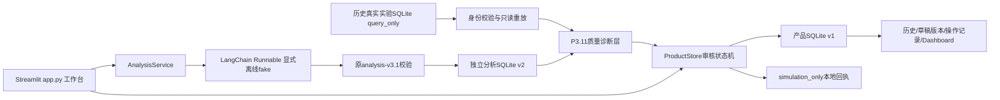

# P3.11–P4 实际系统设计

候选身份：`complaint-product-p4-rc1`，2026-10-18，Asia/Shanghai。在现有 Python / Streamlit / LangChain / SQLite 模块化单体上增量实现，没有替换历史分析契约，也没有晋升 P3.10 Challenger。

## 模型与 LangChain 的实际边界

既有真实链路为 `AnalysisService → DeepSeekAnalyzer → LangChain ChatOpenAI → DeepSeek → strict_json → 版本化Schema/原文校验 → SQLite → 新连接重读`。Prompt、模型别名、参数、Schema、原文、raw、解析阶段、错误、时间和用量均保存在历史 run。P3.9 context profile 由独立 reader 分派，避免用旧 v3.1 reader 错读新接受语义。

本轮没有新付费授权。`app.py` 在加载业务入口前强制关闭 live/API/tracing；工作台没有付费 provider 分支。旧研究UI仍可读，但服务器授权开关在此候选版中不可打开。CLI旧实验源码保留，旧账本继续锁止，不运行其付费入口。

新增 `ProductFake` 通过 LangChain `RunnableLambda` 返回明确编写的工程fixture，随后进入原 `AnalysisService` 的解析、契约、持久化链。LangChain在这里编排和保留调用边界，没有进行模型推理。固定场景改变正文须转入自定义模式；自定义模式只生成明确的 unknown 占位结果，不能把它当自然语言模型能力。真实能力展示使用已保存模型结果的只读重放。

## 模块职责

|模块|实际职责|不承担的能力|
|---|---|---|
|`product_sources.py`|固定本地来源目录、query_only SQLite、原版本reader、run身份读取|不复制预算或发新请求|
|`product_quality.py`|五项政策登记、闭集语义锚点、证据跨度、风险/紧急度冲突、回复动作门禁|不改模型预测，不证明完整语义正确|
|`product_workflow.py`|来源快照、不可覆盖草稿版本、事务状态迁移、审核原因/身份/核对项、模拟回执|不连接SMTP/CRM，不提供生产角色权限|
|`product_workspace.py`|输入、来源标签、Issue/Evidence、编辑、审核操作、历史与统计|不直接写SQL或批准内容|
|`p311_audit.py`|附件hash、14条真实run及原接受状态核验、244条同raw新旧分层诊断|不回填Gold、旧分母或人工分数|
|`p4_demo.py`|独立演示目录、全纵向操作与SQLite重读收据|自动化行为一律demo_test，不代签人工审核|

## 三种状态始终分开

1. 原模型/实验：`run.status`、原契约接受与raw保持冻结。
2. 新政策诊断：`product-quality-guard-v1` 的 block/review 候选，附 `owner-adjudication-v1` hash。原接受可以同时存在政策冲突。
3. 产品工作流：草稿是否批准、拒绝、退回或模拟发送；任何来源均从未审草稿开始。

五项研究者政策、开发者诊断、完整回复人工评价与独立Gold各有身份。没有将14份完整回复批量签为通过，没有虚构N33纠错。

## 设计选择与限制

产品库与分析库/研究库分开，牺牲跨库单事务换取实验零写入。若分析已保存而产品快照写入失败，重试分析复用原成功run，`source_key` 保证快照不重复；分析失败保留诊断，不构造草稿。产品内部每次操作与事件、版本或模拟回执在同一 `BEGIN IMMEDIATE` 事务中完成。

单机本地审核人标识是可声明的身份，没有登录、签名或多租户隔离。`local_human`由实际操作者选择，默认 `demo_test`；验收脚本和浏览器自动化只用后者。审核记录不能当独立双人盲评。状态机阻止产品接口绕过，不防拥有SQLite文件写权限的恶意管理员。真实发送始终不存在。
