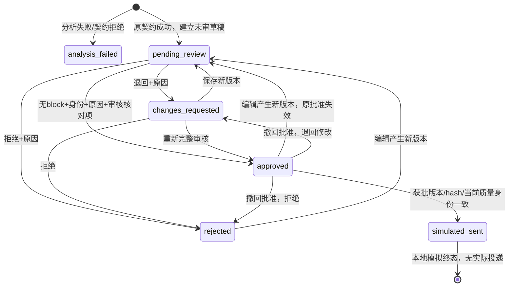

# SQLite、审核与恢复

候选产品库独立使用 `user_version=1`。原分析库保持SQLite v2，历史库只以 URI `mode=ro` 与 `PRAGMA query_only=ON` 打开。ProductStore拒绝把已有实验v2库当产品库迁移；仓库内写入仅允许 `.local/p4/`。没有原库搬移或破坏性迁移。

## 产品表

|表|主键/约束|保存内容|
|---|---|---|
|product_cases|case_id；source_key唯一|原run完整快照、快照hash、原接受状态、真实重放/fake来源、来源路径、建立时间|
|product_workflow|case_id外键；合法状态CHECK|当前草稿version、操作revision、当前状态|
|product_drafts|case_id+version|不可覆盖正文、body hash、当时质量诊断、编辑身份/类型/时间|
|product_events|event_id；operation_id唯一；case_id+revision唯一|前后状态、动作、草稿version、原因、核对项、身份类型、时间、请求hash、诊断身份|
|product_simulations|case_id唯一；mode固定simulation_only|获批正文快照、正文hash、草稿version、receipt_id及时间|

草稿和操作事件具有禁止更新/删除触发器；来源快照和模拟回执不可更新。业务代码无删除入口。原文/配置/raw与原run相等，来源快照hash、草稿hash及对应原版本校验在重读时验证。所有时间存UTC ISO8601，文档和演示日历用Asia/Shanghai；不把服务端UTC误报成本地时间。

`analysis_failed`不可审核或发送。`simulated_sent`正文锁定，重开只能查看；另行处理须建立新分析版本，不修改已审核内容。旧草稿版本可查看和diff，不能直接发送旧版本。相同正文保存是无操作，避免无意义版本。

## 审核门禁

批准须填写本地身份、原因及三个核对项：事实/Evidence/标签/主次，商家资料责任/渠道/隐私/动作权限，全诉求覆盖与未来能力。严重风险另需明确安全审核。检查项每个草稿版本独立；UI有未保存编辑时禁止批准/模拟发送。

block不可由人工勾选绕过。回复缺陷可编辑后重查；分析本身的严重风险低估、无证据延误、预约投诉被取消等缺陷不能靠换一篇回复解除。应拒绝当前案例、保留原预测，未来另版本再分析；本轮没有真实调用授权。

复杂语义保持 `review_required`。勾选核对项是操作记录，不能作为模型准确率、Human Gold或没有漏报的证明。

## 幂等与异常恢复

|情况|实现行为|验证方式|
|---|---|---|
|重复建立同来源|source_key唯一，保留已有审核状态|集成测试|
|重复批准/发送|相同operation_id绑定请求hash；状态不重复，发送回执唯一|重试/重读测试|
|旧页操作/两个同时批准|expected_revision+SQLite写锁；第二个操作需重读|并发集成测试|
|编辑已批准正文|新version；state回到pending_review|AppTest、服务测试|
|未审核/拒绝/失败/阻断尝试发送|服务端拒绝，不只依赖按钮禁用|状态矩阵测试|
|SQL写入或事件写入失败|整个事务回滚，版本/回执不残留|故障注入，SQLite重读|
|提交完成但响应读取失败|同operation_id重试回到已有状态；UI不宣称成功，历史可恢复|故障注入|
|质量政策变更后再发送|重新计算质量并比对批准时诊断身份，要求退回重新审核|集成测试|
|刷新/新会话/重启|case_id查询参数和工作历史读取SQLite|AppTest、实际浏览器、演示脚本|

操作记录和已保存正文不会依赖Streamlit session存活。尚未点击“保存新版本”的文本属于页面编辑状态，进程突然退出无法保证恢复；页面内可恢复写入失败后编辑。本地SQLite单机，无生产负载SLO或灾备能力主张。

## Dashboard口径

既有400条历史Dashboard及P3版本化归属统计继续保留。P4统计另设来源+完整cohort分组，显示总案例、原契约接受、失败、当前阻断、业务统计分母及negative数。业务分母为原契约成功且没有分析block的案例；raw诊断和明确分析冲突排除。回复block不改变已有分析标签，但不能模拟发送。

成员列表提供所有case_id及业务分母成员，可回到原文。不同Prompt/model/backend不混合；同邮件不同真实实验run仍是不同分析版本，分组并不意味着独立客户计数。契约通过和有界诊断没有阻断仍不构成独立语义认证。
