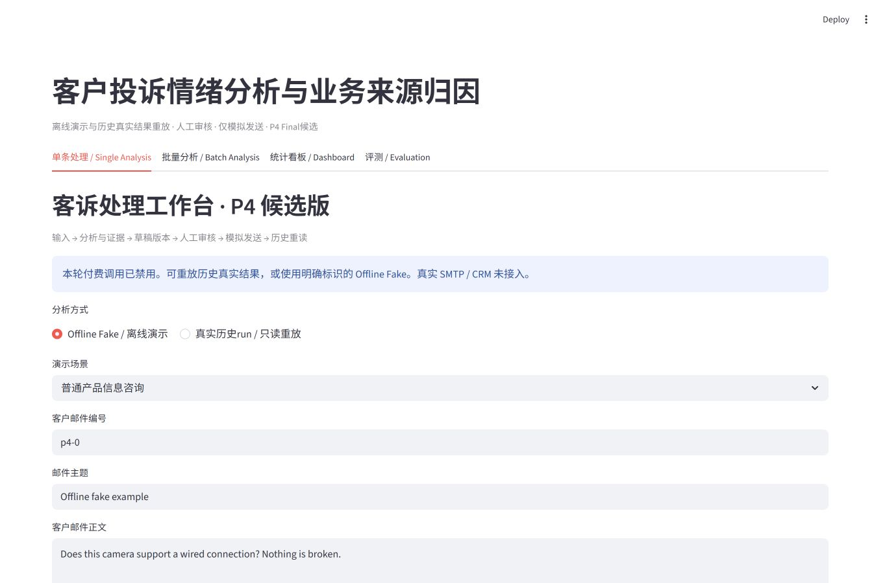
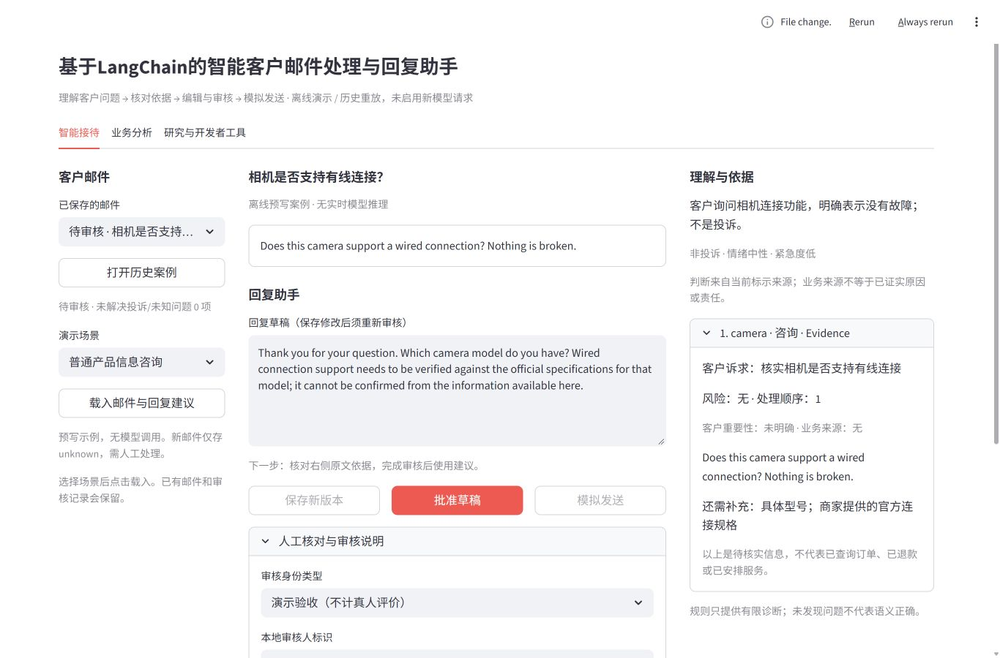
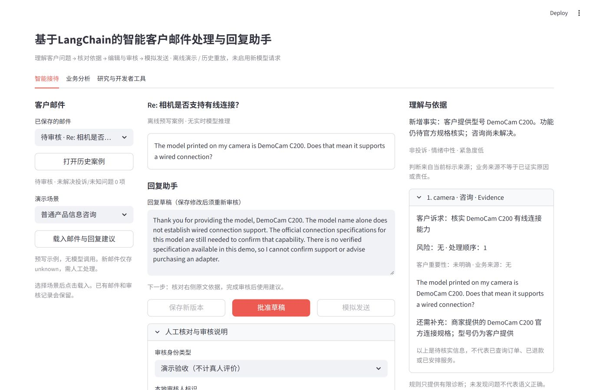
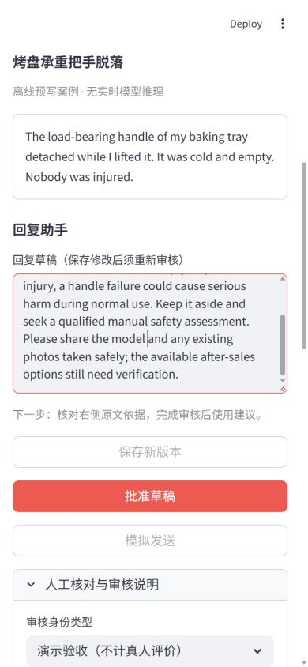
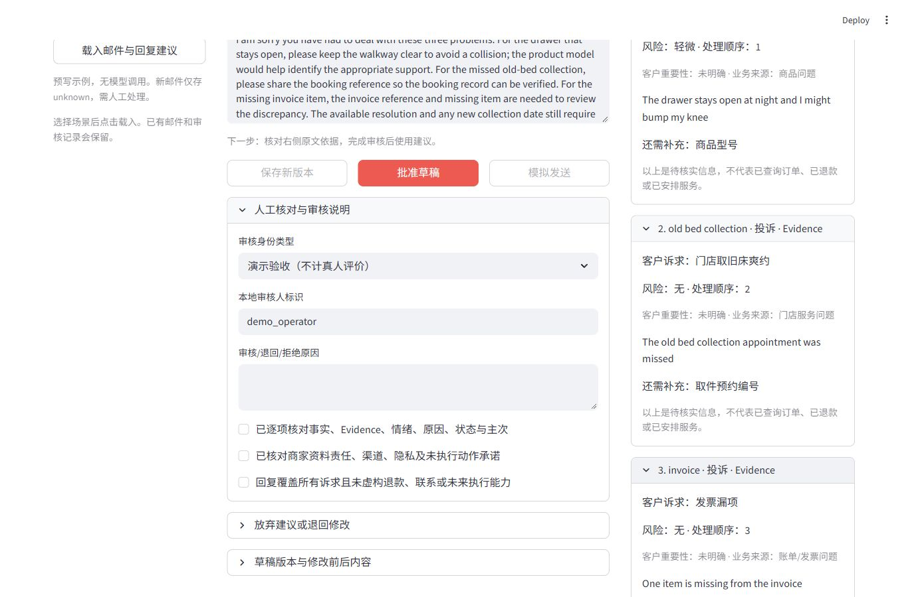

# P4.5 验证记录

日期：2026-10-27（Asia/Shanghai）。基线 `f5fa68850e4d4af428ba952cc07bf49f58e89468`。本机完整日志和新建工作库位于 `.local/p4/p45-20261027/`，不进入公开仓库。截图仅包含显式合成演示内容。

## 真实界面证据

重构前与重构后的真实 Streamlit 首屏，均为 1366×900：

最终第二轮来信首屏（新型号出现在邮件、回复与缺失信息说明中）：

基线载入普通咨询后的回复框位于文档 y≈1731，需滚动。新普通咨询回复框 y≈459，最终第二轮 y≈485、高150、宽≈569；1366×900 首屏包含原文、草稿与操作。截图不是生成 Mockup。普通咨询截图右上角的 File change 提示来自本地开发过程，最终截图已无该提示。

390×844 窄屏使用顺序堆叠，草稿与按钮可操作，需要纵向滚动：

三个 Issue 全部实际展开，与回复逐项对应：

1440×900 另完成严重风险页面检查，原始截图在本机证据目录。没有宣称移动端所有设备、暗色主题或所有辅助技术已经验收。

## 浏览器点击与结果

通过真实 in-app browser 操作本地 8536 服务，使用独立 P4.5 库。中途浏览器权限关闭及服务中断后，用户重新开启，已恢复并完成剩余验收。

| 验收项 | 实际路径与观察 |
| --- | --- |
| 首次打开 | 空库直接预览咨询与建议；未点击载入前不产生案例。桌面首屏可见主要任务 |
| 咨询与信息不足 | 智能接待 → 普通产品信息咨询 → 载入。非投诉，询问型号及官方规格，无臆造有线能力 |
| 三 Issue | 打开历史三问题邮件 → 分别展开取件、发票。三段原文与回复完整对应 |
| 雨淋包裹 | 载入配送已送达场景。明确已送达与包装受损；不改成配送延误 |
| 修改与重新审核 | 相机草稿编辑 → 保存 v2 → 展开版本 Diff。未完成核对时批准被拒；填写演示原因、勾选三项后批准 → 模拟发送。终态显示 v2 回执，无真实发送 |
| 严重风险 | 烤盘仍 severe/high，包含停止使用、不复现；自行车故意低估分析触发独立阻断，保存安全措辞后批准／模拟发送仍不可用，拒绝记录保留 |
| 邮件往返 | 相机模拟发送后 → 保存预设后续邮件。第二轮引用 DemoCam C200，仍缺官方规格；展开历史包含客户、模拟客服、客户三条 |
| 历史恢复 | 刷新、重开、新服务进程连接同库。原 v2 草稿、回执、三条往返及 save_edit/approve/simulate_send 事件仍存在，actor_type 为 demo_test |
| Dashboard | 业务分析 → 门店 → 需人工介入：正常烤盘组为0；切换自行车组为1、可统计分母0；下钻链接新开同一已拒绝邮件。修复新增案例后来源选择重置／成员错位；追加 AppTest 覆盖 |
| 来源辨识 | 研究页列出四类来源与 LangChain 路径。新自定义邮件明确 unknown、未进行 AI 理解，不套用预写分析 |
| CSV | 研究 → 批量分析 → 上传本轮单行 CSV → Run batch analysis。1行 legacy_mock 成功，新 UUID 导出，不覆盖历史 outputs |
| Evaluation | 上传本轮预测与显式编写的单行参考。Core seven-field 正确拒绝缺 source_attribution；切换 Legacy six-field 得到6项 support=1 的管道结果。不是模型质量成绩或独立 Gold |
| 错误隔离 | 上传0字节预测 CSV，显示有效UTF-8 CSV提示；返回智能接待，原文、草稿、风险与操作仍可见 |

## 自动化与资产保护

最终全量 **418/418 通过**，0失败、0错误、0跳过，601.042秒（`full-release.txt`）。干净目录 Portable **324项：317通过、7跳过、0失败／错误**，486.160秒（`portable-release.txt`）；7项均依赖未公开私有历史资产，不计为通过。命令为 `python -B tests/run_offline.py` 与 `python -B scripts/run_portable.py`。运行器禁用外部 socket、paid/live/tracing，临时数据库隔离，并以审计钩子拒绝写历史研究资产。终端中的模拟 budget/token 记录来自 fake fixture，不是新付费调用。

新增 `tests/test_copilot.py` 共9项，覆盖9场景契约与门禁、固定输入身份、后续主题变更降为unknown、陌生 sidecar 拒绝、关联篡改、线程不可变与幂等／冲突／恢复、关联失败重试、第三轮上下文保留、统计去重／unknown／未解决口径，以及实际 app.py 的导航和下钻身份。

全量保留既有 P4 审核、revision/hash、幂等模拟发送、真实 SDK＋Mock HTTP 及研究资产保护测试。Portable 在仅含受跟踪文件和本次显式新增源码的干净临时目录运行，无 `.env`、原数据、历史 raw 或工作库。私有历史回放相关 skip 必须单独列出，不计为通过。

本轮早期失败与修复均保留本机日志：Streamlit 已实例化 widget 的 session_state 修改异常，已改为下一次渲染前选择；Windows SQLite 测试连接未关闭导致临时目录清理失败，已显式关闭；看板动态选项造成选择错位，已改稳定字符串身份及独立选择状态。门店／日期未解决计数补按案例所有 Issue 判断。修复后重新运行，不隐藏失败记录。

保护核验包含11,687个既有资产的 SHA256（data、outputs、历史 .local、论文、原未跟踪成果及 .env），**0改变、0丢失**，结果在 `asset-verification-final.json`。新增证据和导出只写本轮目录。依赖 `pip check`、`git diff --check` 已通过。

## Git 与回滚

独立分支 `codex/p45-customer-copilot`，增量基于 `codex/p4-final-p5-preflight`。PR #3 继续是面向 main 的 Draft，基线头保持不变。本次仅显式白名单源码、测试、交付文档和合成截图进入提交；不提交 SQLite、账本、.env、真实客户数据、私人研究 raw 或原未跟踪研究文档。

审阅以新 Draft PR 的该基线为准，不与 main 的累计历史改动混淆。最终 commit、push 和 PR/CI 状态记录在本机 `git-receipt.json`，交付消息提供可核验链接。

代码回滚：在独立目录检出基线，或对本次增量提交做普通 `git revert`（仍须遵循后续任务授权）；不使用 reset/force push。产品库、分析库和线程 sidecar 一并保留；旧代码忽略新 sidecar，无需降级或删除数据。切回旧 UI 会暂时失去线程展示，不代表消息被删除。

独立 Human Gold、holdout、完整回复语义认证、真实商品知识检索和动态多轮生成仍未完成；本阶段没有据此提高历史准确率或晋升模型。
