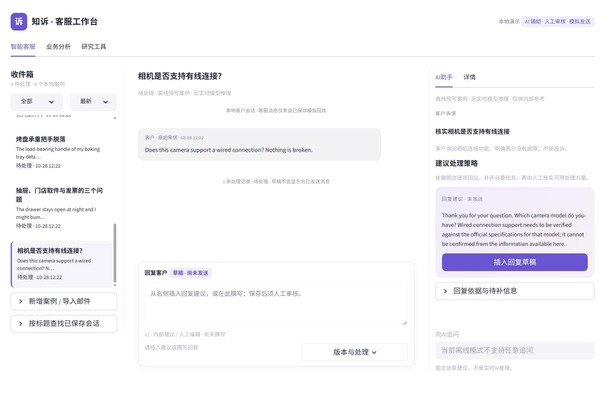
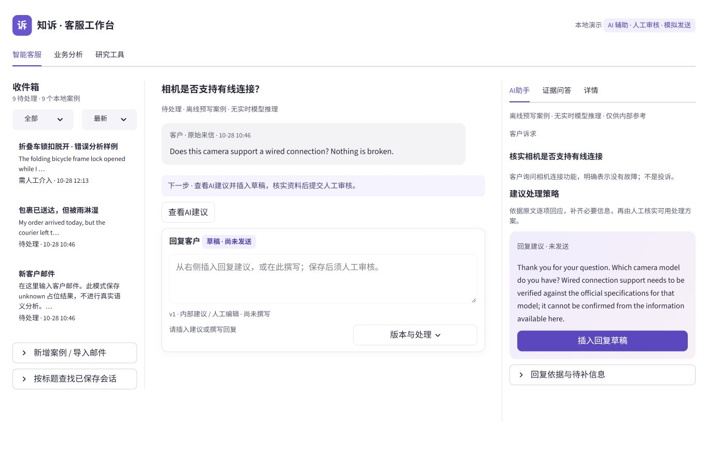

# P4.6.1 工程与真实浏览器证据

2026-10-28（Asia/Shanghai）。基线 `7df9768ac2c315f2428ab72e4d2ba8f8471253b8`，普通增量更新Draft PR #4。私有机器日志、工作库和冻结清单位于 `.local/p4/p461-20261028/`。公开截图仅含明确合成验收案例，来自真实Streamlit浏览器，无生成图或拼接。

## 同视口前后

| 视口 | 修改前 | 修改后 |
| --- | --- | --- |
| 1366×900 | [首封](refinement-screenshots/before-1366.jpg) | [首封](refinement-screenshots/after-1366.jpg) |
| 1440×900 | [首封](refinement-screenshots/before-1440.jpg) | [首封](refinement-screenshots/after-1440.jpg) |
| 1024×900 | [对话](refinement-screenshots/before-1024.jpg) | [对话](refinement-screenshots/after-1024.jpg) |
| 768×900 | [对话](refinement-screenshots/before-768.jpg) | [对话](refinement-screenshots/after-768.jpg) |

修改前1366：

修改后1366：

首封四尺寸回复框y≈492/492/529/529，94px编辑视区完整可见；主滚动区域900px，scrollWidth=clientWidth。实际DOM：客户正文16px、编辑器16px、建议15px、时间13px、辅助13px。辅助色#53586b、opacity=1；白底对比约7:1，消息灰底时间亦超过4.5:1。此为关键样式和实图审查，不宣称全应用自动WCAG认证。

## 实际操作

| 验收 | 结果与证据 |
| --- | --- |
| 首封任务与编辑器 | PASS；四尺寸同案例实图，消息后立即出现下一步和回复 |
| 三轮客户来信与两次模拟回执 | PASS；全部经保存流程，第三轮明确为合成验收并保留unknown来源；[1366](refinement-screenshots/three-rounds-1366.jpg)、[1440](refinement-screenshots/three-rounds-1440.jpg)、[1024](refinement-screenshots/three-rounds-1024.jpg)、[768](refinement-screenshots/three-rounds-768.jpg)；最新上下文局部滚动，编辑器仍可见 |
| 离线真实问答 | PASS；自然语言输入、执行、回答和依据展开；[配送分类原文](refinement-screenshots/qa-grounded-final.jpg) |
| 缺少规格 / 超范围 | PASS；相机问答明确不确定；写诗请求拒答；本机qa-missing-spec.jpg、qa-unsupported.jpg |
| 第二轮已知信息 | PASS；问答引用DemoCam C200，不再次索要型号；本机qa-known-model.jpg |
| 切案隔离与错误恢复 | PASS；从风险切至配送后输入与历史为空；空问题错误后可正常提问；本机qa-empty-error.jpg |
| 问答不改草稿或发送 | PASS；问答后编辑器仍为空、无发送按钮；事务测试核对ProductStore与消息未变 |
| 插入、编辑、保存、审核、模拟 | PASS；首轮v2插入、v3人工改写、demo_test审核与模拟；第二轮v2审核与模拟；本机review.jpg、simulated-sent.jpg |
| 风险不可绕过 | PASS；问答后仍标人工介入，插入后批准disabled、发送入口不存在；[阻断审核](refinement-screenshots/risk-review-block.jpg) |
| 刷新与服务重启 | PASS；已保存案例、草稿、回执、问答恢复；未保存输入不保证恢复 |
| LangChain Mock HTTP | PASS；真实SDK受控传输，单次派发、引用/Schema/usage校验、deadline、5xx、预算、持久化和幂等；tests/test_copilot_questions.py |
| 真实Provider自由问答 | 未实施，待独立授权及验证；不能用Mock结果替代 |

初轮回归失败和浏览器早期截图均保留。本轮修复了动态下一步导致编辑器delta位置变化、失败Case无draft的空值访问、新页签列表断言；测试ID未删除。开发热重载时曾出现投影身份错误，未放宽校验，关闭热重载并重启重读后，同一保存第二轮通过审核及模拟。建议稳定候选验收期间使用 `--server.fileWatcherType none`。

## 自动化、资产、审阅与Git

完整离线 **445/445通过**，0失败/错误/跳过，580.890秒（`full-final.txt`）；原427（包含原418）ID全部保留，新增18项问答测试。最终差异问答专项 **18/18**，30.470秒（`questions-release.txt`）。原编辑器/审核/线程专项14项亦通过。

干净Git索引检出 Portable **351项，344通过、7跳过、0失败/错误**，502.595秒（`portable-final.txt`）。7项均依赖未公开的私有历史资产，不计为通过。干净目录不含.env、研究数据或本机工作库；使用已有固定依赖环境。源码blob身份和路径保存在`portable-source-final.json`，最终交付代码与其逐项核对；精确提交Ubuntu CI另外核验。

历史资产 **12,262文件：0改变、0丢失**，包括原raw、synthetic、Gold、outputs、预算、SQLite、.env及59项既存未跟踪成果；见本机`asset-check-precommit.json`。没有删除旧测试ID或清理未跟踪文件。`pip check`、10个变更Python文件AST解析和`git diff --check`通过。公开图片按精确路径/hash逐项检查合成来源并列入manifest，其他载荷按显式白名单、凭据模式及已知本机密钥扫描。Code Review为开发代理审阅，不冒充独立真人审核。

截图交付前逐张检查JPEG像素尺寸。早期多标签浏览器视口覆盖造成的尺寸不符图片保留在本机；公开前后四尺寸全部重新在单一活动标签核拍，修改前使用冻结恢复副本运行原始`7df9768`，源码hash另核对，未使用生成图模拟基线。

Git以普通commit/push更新原Draft PR #4，不强推、不合并main、不Tag/Release。精确最终commit、tree、CI运行及结论以PR Checks、最终交付消息和本机`git-delivery.json`为准。

| 本轮成功标准 | 结论 |
| --- | --- |
| 首封/多轮任务路径与四尺寸布局 | PASS |
| 字号、对比度、层级及关键状态可读 | PASS |
| 当前Case可操作离线证据问答及拒答 | PASS |
| 问答隔离、持久化、草稿/审核/阻断回归 | PASS |
| 实时调用边界及真实SDK Mock HTTP工程验证 | PASS |
| 真实Provider自由问答、模型语义质量 | PARTIAL：未授权、未执行，需独立实验 |
| 研究者最终接受/拒绝 | 未填写，由研究者亲自验收 |

真实模型新增请求0；SMTP/CRM真实发送0。实际.env旧API开关开启且未修改，应用/测试强制关闭paid/live/tracing；离线Runner阻断外部socket。内部问答与模型预测均不是人工Gold，研究者决定见候选清单，保持空白。
