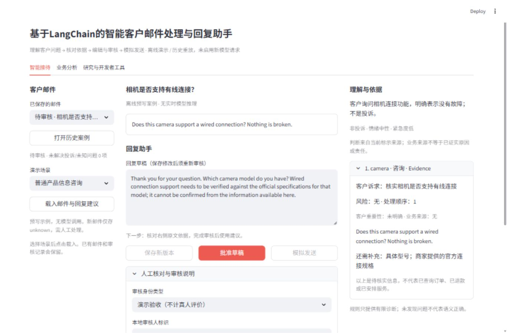
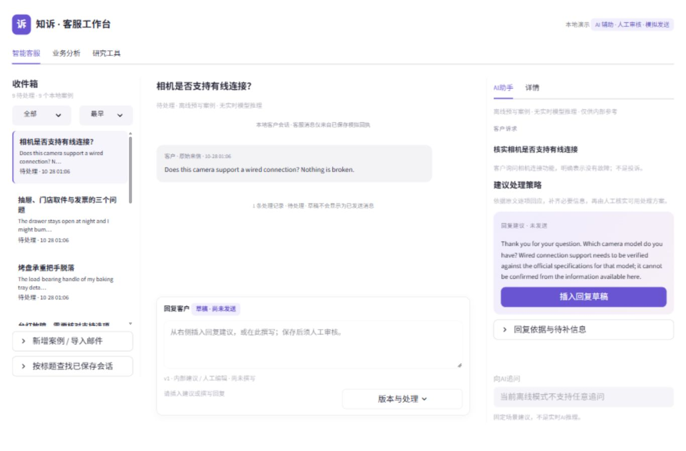
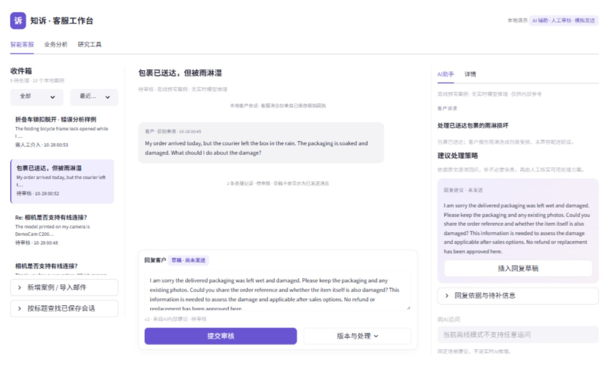
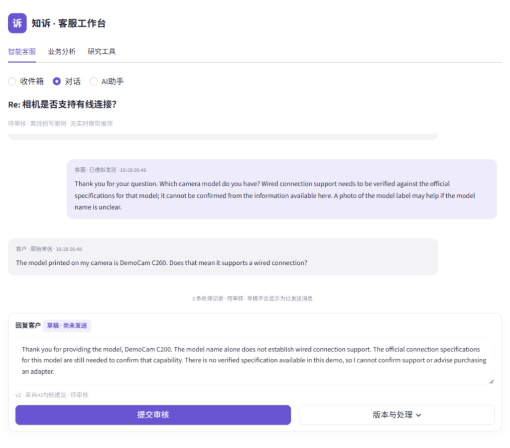
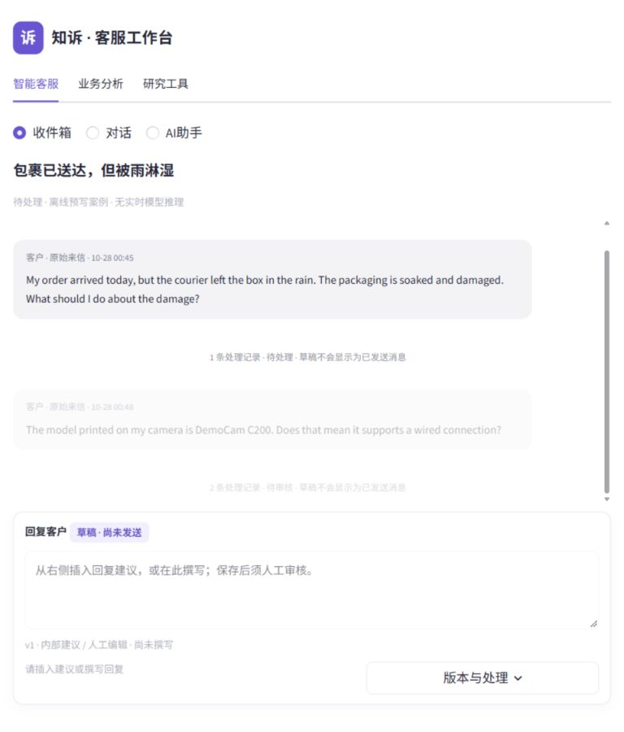

# P4.6 真实验收记录

2026-10-28（Asia/Shanghai）。本机详细日志和隔离工作库位于 `.local/p4/p46-20261028/`。浏览器是真实 Streamlit 8546 服务，所有可公开图片仅含明确合成案例；没有生成 Mockup。基线为 `6cdb7ee1fb51a0d2b02a22bd0e561572d9bf0c57`。

## 重构前后

P4.5 普通咨询的真实首屏：

P4.6 中文收件箱（相同普通咨询，建议需明确插入）：

配送受损案例已插入草稿的 1440×900 首屏：

## 实际浏览器操作

| 验收项 | 状态 | 操作与证据 |
| --- | --- | --- |
| 1366×900 首屏 | PASS | 左选客户、中客户消息/编辑器、右内部建议与插入按钮同屏；`after-inquiry-1366.jpg` |
| 1440×900 | PASS | 页面主滚动区高度900、宽1440；回复框 y≈641、高94，操作在900内；`after-1440.jpg` |
| 1024×900 | PASS | 自动只显示当前工作区域；对话宽992，主滚动高度900；`after-1024.jpg` |
| 768×900 | PASS | 收件箱选配送邮件 → 对话 → AI助手 → 插入后回对话；回复框 y≈678、高94、宽705；`after-768.jpg` |
| 首次选择与切换 | PASS | 空库预览不造案例；新九场景库点击行立即同步主题、原文、建议与 case URL。AppTest 另验证未保存缓冲不串案 |
| 插入建议 | PASS | 空编辑器插入保存新版本；已有文本出现追加/替换/保留原稿选择；浏览器执行替换，AppTest执行取消/追加及刷新恢复；本机 `insert-choice.jpg` |
| 编辑、保存、Diff | PASS | 咨询 v2插入、v3同文替换、v4人工补充；版本中保留 v1 原建议；本机 `draft-diff.jpg` |
| 审核与模拟发送 | PASS | 无说明/未核对批准失败；demo_test完成后批准、模拟、刷新；客服气泡与回执为v4，没有再次发送操作；本机 `manual-review.jpg`、`simulated-sent.jpg` |
| 多轮及重启恢复 | PASS | 客户/已保存模拟客服/客户三条原消息按时间保留；重启服务后第二轮建议与草稿仍含 DemoCam C200，不重复索要型号；本机 `multiturn-1366.jpg` |
| 严重风险及不可绕过阻断 | PASS | 折叠车插入后仍人工介入；审核批准按钮 disabled，模拟发送按钮0个；服务层另拒绝编辑后批准；`risk-block-1440.jpg` |
| 五类内容审阅 | PASS | [单独的开发代理审阅记录](CONTENT_REVIEW.md)，不冒充真人语义评分；原 Fixture/raw 不改 |
| 三 Issue 原文 | PASS | 展开抽屉、旧床取件、发票三个 Evidence；中间与右侧同案；本机 `multi-issues-details.jpg` |
| 数据来源 | PASS | 主界面标记预写或历史来源；研究工具列四条执行来源与 LangChain 边界；本机 `source-explanation.jpg` |
| 业务统计与原文下钻 | PASS | 风险维度、版本组分母、unknown/failed/fallback说明；读取成员深链回到同一第二轮案例；本机 `business-risk-drilldown.jpg` |
| 旧 CSV | PASS | 本轮显式单行 CSV上传、legacy_mock运行和新UUID导出；未进入产品审核库；本机 `legacy-csv.jpg` |
| 旧 Evaluation | PASS | 显式单行预测与独立编写参考；七字段拒绝缺source_attribution，六字段兼容产出support=1的6项管道指标；不是模型质量成绩；本机 `legacy-evaluation.jpg` |
| 输入错误隔离 | PASS | 0字节预测显示有效UTF-8 CSV提示；返回智能客服原草稿可用；本机 `evaluation-error-isolation.jpg` |
| 无装饰性操作 | PASS | 会话行、导入、插入、版本、审核、模拟、线程及下钻均实际执行；任意AI追问明确禁用，未造模板推理 |
| 中英文 | PASS | 英文原文及回复保留原语言；中文unknown样例可载入与恢复；UI业务导航为中文 |

窄屏对话模式实图：

测试中修复了对话框仅片段重跑时的状态保留、widget key与插入请求冲突、响应式容器实际层级和旧v1已批准草稿显示。早期失败日志保留。浏览器一次上传重渲染误触样本生成，只写入新的 `.local/samples/UUID` 合成兼容样本，没有触及旧数据；后续重新观察完整渲染状态再操作。

## 自动化、资产与发布

完整回归 **427/427通过**，0失败/错误/跳过，697.585秒（`full-release.txt`）；本轮开始418个测试ID全部保留。新增9项覆盖插入事务、来源、冲突、同文撤销审核、终态、安全阻断、串案、确认/恢复、旧v1兼容。拒绝状态不能靠同文插入重新开启审核。最终展示层邮件Markdown转义另执行9/9 UI与事务补充回归，38.978秒（`p46-release-ui.txt`）。

独立干净目录 Portable **333项：326通过、7跳过、0失败/错误**，485.744秒（`portable-delivery.txt`）。7项均依赖未公开的私有历史资产，不计为通过。通过Git索引检出到新的临时目录，无.env、研究data或本机数据库；代码/测试/配置blob逐项匹配，使用现有固定依赖环境，源码身份保存在`portable-source-delivery.json`和`final-source-review.json`。之后仅补充详情区的待核实门店与旧v2商品展示，另通过9/9回归、23.436秒（`details-ui-final.txt`）；最终精确SHA的干净Ubuntu Portable CI以PR Checks及收据为准。

原 **11,743个** data/outputs/历史.local/论文/未跟踪成果/.env 文件SHA256核对：**0改变、0丢失**；未删除旧测试ID。公开载荷按显式白名单审阅，已知本机密钥及凭据模式扫描无发现；11张P4.5/P4.6合成场景截图逐项允许，其他研究raw、Gold、SQLite与原未跟踪资产不发布。此扫描不宣称普适安全认证。`pip check`、Python AST检查和`git diff --check`通过。

Git使用普通增量提交。HTTPS推送发生connection reset，改用已授权GitHub Git Data API逐项核对blob、tree、commit，保留作者/提交者/时间及父提交，不强推。P4.5已发布的commit仍为`6cdb7ee1fb51a0d2b02a22bd0e561572d9bf0c57`，tree为`9642fcd2b2118502f65de65f5baf42178bcd83cc`，该精确SHA的push CI已成功。P4.6以PR #3的`codex/p4-final-p5-preflight`（f5fa688）为基线创建增量Draft；最终commit/tree、PR及精确提交CI链接以交付消息和本机`git-delivery.json`收据为准。没有合并main、强推、Tag或Release。

新模型请求0；真实发送0。完整回归与Portable均使用外部socket阻断、paid/live/tracing关闭和历史资产写保护；模拟budget/token日志均为fixture，不是付费请求。历史真实回放相关私有资产skip单独列出，不计为通过。
