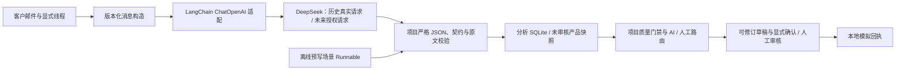

# LangChain 的实际作用与演示边界

2026-10-28（Asia/Shanghai）。P4.7 保留原分析服务、版本化契约与真实模型适配；本轮运行离线预写案例和规则问答，没有新增付费模型请求。页面上“AI建议”表示客服辅助建议，具体来源必须同时可见，不能凭这个名称推断发生了模型调用。

## 四类来源

|来源|实际执行|可以证明|不能证明|
|---|---|---|---|
|离线预写案例|匹配有输入 hash 的场景，LangChain Runnable 返回预写结果，再经过正式校验与存储|产品流程、版本身份、门禁与恢复|任意邮件理解、模型泛化或真实回复质量|
|离线证据问答|规则识别受限问题，只读本案线程、Issue/Evidence、质量状态和演示说明|引用可追溯、串案隔离、缺资料拒答|开放式模型推理、商品知识或售后决策|
|历史真实模型重放|只读原 run、原文与输出，建立未审核的产品工作副本|该历史请求的原始记录与当前门禁表现|本轮重新调用、修改前后模型能力提升或独立 Gold 成绩|
|真实 SDK + Mock HTTP|实际 ChatOpenAI 请求路径接显式 MockTransport|SDK 适配、Schema/引用/用量校验、超时、预算和幂等|真实 Provider 可用性、语义正确率或实际模型费用|

新真实模型请求在本轮 UI 中关闭；它是需要独立授权和新预算的后续验证路径。已有历史预算不构成本轮额度。

## 源码职责

|位置|职责|
|---|---|
|[copilot_demo.py](../../src/application/copilot_demo.py)、P4.7 版本化场景模块|离线预写场景与 Runnable 编排；旧场景身份保留|
|[deepseek.py](../../src/infrastructure/deepseek.py)：`DeepSeekAnalyzer.make_client/request`|建立 LangChain `ChatOpenAI` 客户端并调用 `ainvoke`，统一消息、超时与返回元数据；关闭 SDK 重试、缓存和追踪|
|[live_prompt.py](../../src/application/live_prompt.py)、[v31_prompt.py](../../src/application/v31_prompt.py)|构造版本化 system/human 消息和 Prompt hash；邮件是待分析数据|
|[analysis_service.py](../../src/application/analysis_service.py)：`analyze/validate_result`|调用 analyzer、严格 JSON/契约/原文跨度校验、兼容投影、分阶段错误与 SQLite 保存|
|[live_execution.py](../../src/application/live_execution.py)|真实请求的预写 claim/attempt、预算预约、显式重试边界、用量与失败留存|
|[product_analysis.py](../../src/application/product_analysis.py)|产品级请求授权及新预算校验；协调已存分析与未审核产品快照恢复|
|[copilot_provider.py](../../src/infrastructure/copilot_provider.py)、[copilot_service.py](../../src/application/copilot_service.py)|独立问答 Prompt 复用真实 LangChain 适配；输出引用只允许本案 reference ID，live 硬关闭|
|[copilot_questions.py](../../src/application/copilot_questions.py)、[copilot_repository.py](../../src/infrastructure/copilot_repository.py)|受限离线问答、上下文快照、问答历史和幂等；不更改草稿或批准状态|
|[product_quality.py](../../src/application/product_quality.py)、[product_workflow.py](../../src/application/product_workflow.py)|项目自有质量门禁、审核、不可变草稿版本、事件与模拟回执；LangChain 不批准、不执行退款、不发送邮件|
|[mail_threads.py](../../src/application/mail_threads.py)、[product_sources.py](../../src/application/product_sources.py)|保存并校验显式线程上下文；只读历史来源，保留原 run 身份|

图中真实调用分支描述既有适配能力与历史链路，不表示本轮启用。当前任意新邮件仍使用明确标识的 unknown 流程占位。当前证据问答为独立规则服务，不经过图中的真实模型分支。

## 与静态模板产品的区别

当前预写演示本身是确定性模板，不能称为实时智能分析。项目已实现的模型路径通过 LangChain 把版本化邮件提示与模型适配放在同一调用接口，随后保留 raw、解析阶段、Issue/Evidence、模型/Prompt/Schema 身份、用量和失败记录；同一应用服务可接离线替身或受控真实 Provider。由此可以复现历史模型结果、验证真实 SDK 请求边界，并在后续授权时替换输入，而不重写审核和存储。

这些价值不要求增加 LangGraph、多 Agent 或 RAG。事务、授权、质量门禁、确定性统计和审计属于项目代码；不能把 LangChain 的结构化输出能力当作业务事实已核实。

## 后续真实接入：尚待实施或独立验证

新邮件分析可复用 `ProductAnalysis → AnalysisService → DeepSeekAnalyzer`，但须先冻结输入范围、模型/Prompt/策略版本，建立新的产品授权和预算，完成 Provider 与人工语义验收后才开放入口。P4.7 的预写回复策略不能直接声称已改进冻结的真实模型 Prompt 或历史分数。

开放式 Copilot 追问可复用 `CopilotService → CopilotProvider`：只传当前会话的保存上下文与可引用资料；引用合法性、失败和用量保存仍保留。现有服务仅允许 MockTransport，真实分支需要单独实现授权与预算门禁并验证。缺少官方商品规格、订单记录或政策时，真实模型也必须表示未知，不能以推理补造事实。

验收入口：[精简研究者复核清单](REVIEW_CHECKLIST.md)。最终工程运行结果见本轮交付/验证报告；本文不填模型正确率或研究者签名。
