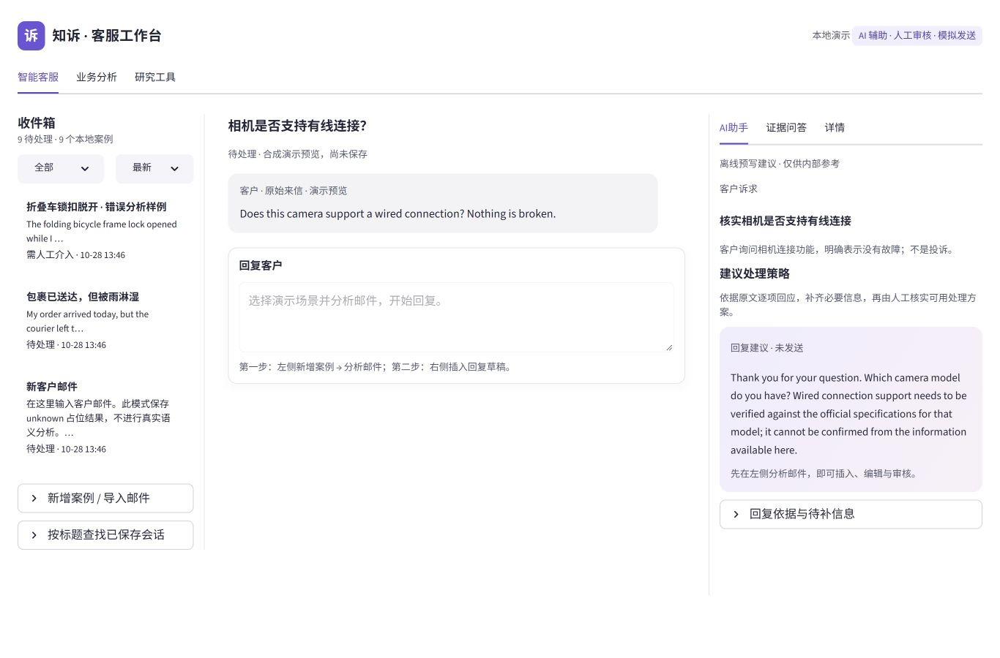
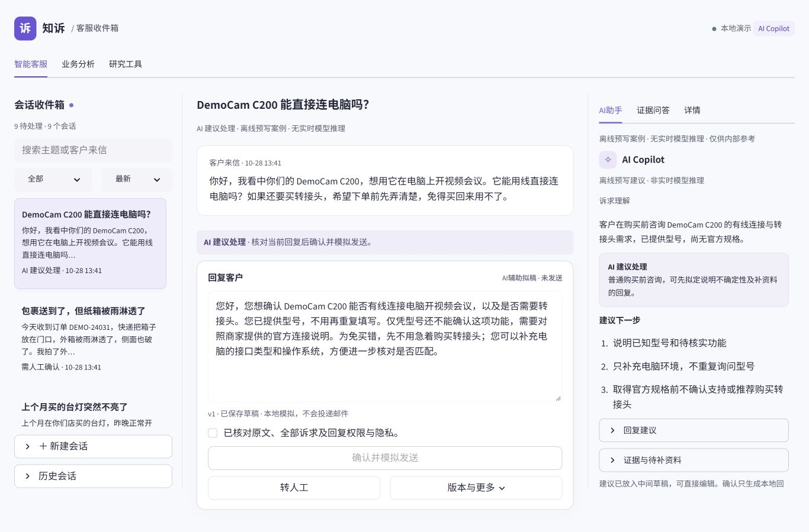

# P4.7 工程验证与真实浏览器证据

2026-10-28（Asia/Shanghai）。基线 `fc48894`；已交付源码提交为 [`2a1078233ce8eec3b9015801c8d5c62c4200ce1d`](https://github.com/BillZhao626/customer-complaint-intelligence/commit/2a1078233ce8eec3b9015801c8d5c62c4200ce1d)，已普通 push 到原 [Draft PR #4](https://github.com/BillZhao626/customer-complaint-intelligence/pull/4)。本轮实现了中文收件箱、版本化回复策略、分层人工兜底与原状态机兼容；最终 V2 真实浏览器复验仍未完成，不能称为全部产品路径闭环通过。

本报告区分离线工程、第一阶段真实浏览器、V2 待复验和研究者人工结论。开发代理审阅与合成场景演示不等于独立人工评测、Human Gold、盲测或真实模型质量成绩。

## 自动化与精确源码身份

| 验证 | 结果 | 采样范围与限制 |
| --- | --- | --- |
| 发布前完整离线回归 | **495/495 通过**，755.627 秒；0 失败/错误/跳过 | `release-full.txt`；在最后一次旧版审核弹窗收拢前采样，不能单独替代最终冻结源码复验 |
| 发布前干净 Portable | **401 项：394 通过、7 跳过、0 失败/错误**，567.594 秒 | `release-portable.txt`；干净源码导出，使用既有固定依赖环境，无研究原文或本机工作库；同样早于最后一次旧版弹窗收拢 |
| 最后一次旧版弹窗调整后的 UI 专项 | **5/5 通过** | 验证旧场景审核控件与原路径兼容；不代表全量或真实浏览器 |
| 最终冻结源码完整离线 | **495/495 通过**，724.221 秒；0 失败/错误/跳过 | `frozen-full.txt`；最终工程文件与源码提交逐项比对一致 |
| 最终冻结源码干净 Portable | **401 项：394 通过、7 跳过、0 失败/错误**，565.958 秒 | `frozen-portable.txt`；独立干净源码副本；工程源文件hash与当前源码一致 |
| Python 静态检查与依赖 | **通过** | 17 个变更 Python 文件 AST 解析、`pip check`、`git diff --check` |
| 精确源码提交 CI | **两次 success** | [Actions 40645766714](https://github.com/BillZhao626/customer-complaint-intelligence/actions/runs/40645766714)、[Actions 40645760392](https://github.com/BillZhao626/customer-complaint-intelligence/actions/runs/40645760392)，对应上述精确源码提交；CI 不含尚缺的真实浏览器交互 |

汇总机器收据见 [engineering-results.json](engineering-results.json)。

7 项 Portable skip 依赖未公开的私有历史资产；它们不是模型失败，也不是通过。完整回归使用本机已有资产时的结果与 Portable 无私有资产时的分母分别报告，不相加计算成功率。逐项比较确认此前 445 个原测试 ID 全部保留，新增50项；兼容旧 AppTest 的入口变化通过显式选择旧场景处理，没有删除原测试来制造通过。

离线 runner 在导入业务入口前关闭 paid/live/tracing，阻断外部 socket，使用临时数据库，并通过审计钩子禁止写入历史 raw、synthetic、Gold、outputs 和论文资产。测试只收集明确的 `tests/test_*.py`，未执行历史可能付费的 API 验证脚本。Portable 显式注册新增场景、V2 内容、工作流、UI 与新版证据问答测试，CI 另在独立临时目录执行 P4.7 demo 冒烟。

工程验证覆盖：输入/输出/策略 hash 和版本分派、正式 AnalysisService/SQLite 重读、普通显式轻确认、接管与批准分离、安全核对、旧坏分析不可用改稿解除、未保存缓冲跨案/转交/接管保留、编辑撤销旧批准、退回后实际改稿、操作幂等与两阶段失败恢复、问答上下文隔离和来源引用。以上不认证任意新来信的语义正确率。

## 同视口前后与布局

修改前来自冻结的基线源码服务；修改后来自第一阶段真实 Streamlit 页面。图片只包含明确合成的工程案例，未生成、拼接或伪造产品操作。V2 内容与后续 UI 增量必须另行复验，不能把这些图片当作最终 V2 截图。

| 视口 | 冻结基线 | 第一阶段修改后 |
| --- | --- | --- |
| 1366×900 | [修改前](screenshots/frozen-before-1366.jpg) | [修改后](screenshots/after-1366.jpg) |
| 1440×900 | [修改前](screenshots/frozen-before-1440.jpg) | [修改后](screenshots/after-1440.jpg) |
| 1024×900 | [修改前](screenshots/frozen-before-1024.jpg) | [修改后](screenshots/after-1024.jpg) |
| 768×900 | [修改前](screenshots/frozen-before-768.jpg) | [修改后](screenshots/after-768.jpg) |

1366 同视口首屏：

第一阶段在 768、1024、1440 视口核对到 `scrollWidth == viewport width`，回复编辑器完整可见；窄屏使用收件箱/对话/AI 区域切换，未把三栏压缩在同一窄屏。四尺寸截图及公开文件 hash 见 [截图 manifest](screenshots/manifest.json)。这是已执行范围内的布局检查，不代表最终 V2 全页面、所有操作或完整无障碍认证。

第一阶段安全及普通咨询截图已经留存并作视觉核读；它不等于研究者已经接受候选、签署内容评分或完成 V2 最终人工复核。

## 真实浏览器已经执行的范围

| 路径 | 已执行内容与证据 | 结论范围 |
| --- | --- | --- |
| 普通常见咨询 | 阅读预填建议，操作者明确确认并模拟发送；[普通回执](screenshots/routine-receipt.jpg) | 第一阶段真实浏览器路径有证据；未向真实邮箱发送 |
| 正常严重安全风险 | 接管前受限 → 本地接管 → 核对事实和独立安全项 → 审核 → 模拟；[接管前](screenshots/safety-before-takeover.jpg)、[审核](screenshots/safety-review.jpg)、[回执](screenshots/safety-receipt.jpg) | 第一阶段正常 severe/high 案件有证据，不代替故意低估坏分析的浏览器阻断复验 |
| 配送原文、回复与证据问答 | 核对已知订单、现有照片、本体状态未知及问答依据；[配送回复](screenshots/delivery-reply.jpg)、[证据问答](screenshots/evidence-qa.jpg) | 有第一阶段内容与问答交互证据，不证明 V2 申请规则展示或完整售后处理 |
| 明确人工请求进入待办 | [人工请求](screenshots/human-request.jpg) 显示等待人工及接管入口 | 只证明该可见状态；接管后的完整浏览器路径仍待补 |

下列项目保持 **PENDING_BROWSER**：

- 普通会话主动“转人工 → 等待人工 → 接管 → 编辑保存 → 重新确认/模拟”的完整真实浏览器路径。
- 客户明确要求人工之后的接管及后续处理，而非仅看到接管入口。
- 旧故意低估安全风险案例在浏览器中改稿后仍不能批准或模拟的反例；服务层/AppTest 阻断通过不替代这项实操。
- V2 担忧、平静、生气三种安全来信、配送售后申请规则、新版问答和最终 UI 的完整浏览器复验；第一阶段截图不作替代证据。

用户已确认权限全部开启，并要求沿用内置浏览器、不再控制桌面；重试后工具仍返回“Local browser use is disabled in Work settings”。这是工具连接与用户设置不一致的可观察状态，不能据此断定用户没有开启权限。本轮没有更改系统或应用权限设置。没有绕过设置改用其他浏览器自动化，也没有把未执行项目填为 PASS。恢复控制后须按 [四条路径与五图矩阵](IMAGE_DEFECT_MATRIX.md) 补证；在此之前不能宣称全部要求已闭环。

## 审计发现、修复及兼容

按 earliest failing stage 与 ownership 区分了三类责任：场景自然度和回复路径由版本化内容策略负责；人工/AI 归属由路由层负责；分析错误、批准与模拟门禁仍由原质量层和状态机负责。新增 severe/high 正常案例没有覆盖旧故意 minor/medium 坏分析，也没有改变旧研究结论。

初轮验证中的 analyzer 身份不一致已修正，早期失败日志保留。新默认场景改变后，旧 AppTest 明确选择原版本场景以继续验证兼容行为，原 ID 未删。Portable 早期漏收 V2 内容模块已补为显式收集。人工待办状态优先于旧批准标签显示；退回/拒绝必须实际修改新版本，安全接管仍不等于批准。

证据问答为 P4.7 增加独立 context/答案版本，按预填草稿、接管、审批与模拟状态说明下一步；引用绑定的场景策略及演示规则，分开客户可补资料和内部核实。已有资料与缺失资料的意图优先级已修正。旧版 context 身份、保存问答与原规则分支保留，没有改写历史回答。LangChain、确定性规则、审核与存储的职责见 [源码说明](LANGCHAIN.md)。

新内容采用独立版本/hash：v1 九类合成场景保留，V2 另增三种安全情绪与配送申请场景；推荐 demo 为 11 个合成会话，场景类别和情绪变体不是独立测试分母。演示售后规则明确不是商家实际条款，不设置未经确认的期限、运费、补偿或批准。完整 before/after 见 [九类对照](SCENARIO_COMPARISON.md)、[v1 内容审阅](CONTENT_REVIEW.md)、[V2 补充](CONTENT_V2.md)。

## 资产、发布与边界

起始 baseline 记录 **13,217 个文件**。从中划定的 **12,766 个保护资产：0 改变、0 丢失**；原 **59 项未跟踪成果保留**，本机 `asset-final.json` 留存逐项核验。保护范围涵盖历史 raw、synthetic、Gold、outputs、研究预算/真实调用记录、旧运行库、论文与 `.env`；工程源码的授权变更与保护资产分开核算，不把两组分母混用。

本轮新增付费模型调用 **0**；真实 SMTP/CRM 发送 **0**。实际 `.env` 的旧 `LLM_ENABLE_API=true` 仍存在且未修改，应用和测试通过自身入口强制关闭 live/API/tracing。模拟回执只保存本地事件；演示申请没有发送给商家、真实坐席或售后系统。

公开交付仅为经白名单审阅的工程源码、配置、文档与合成案例截图，不附私有研究路径清单、真实消费者原文、Gold、预算 SQLite、密钥或用户参考图。用户参考图仅登记本机 hash。源码已更新原 Draft PR，精确源码 CI 如上；后续文档收据提交需保持明确身份，不能把文档提交与已验源码 SHA 混称。

独立代码/内容审阅由开发代理执行，不是独立真人研究评审；真人签署与候选接受决定保持 **PENDING_HUMAN_REVIEW**。本轮不自动启动 P5。独立人工 Gold/holdout、真实模型新预算实验、实际商家规则、生产坐席/发送与身份权限需另行决定。

研究者接受 / 修改后再审 / 拒绝：________________

需修改的会话、草稿版本与理由：________________

姓名 / 日期：________________
