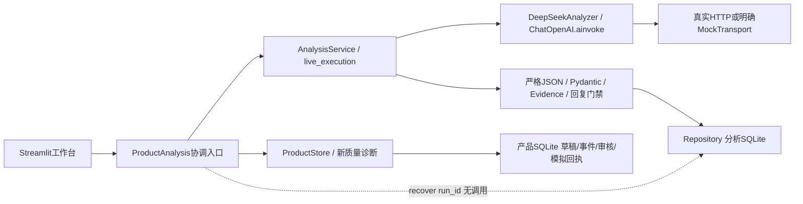
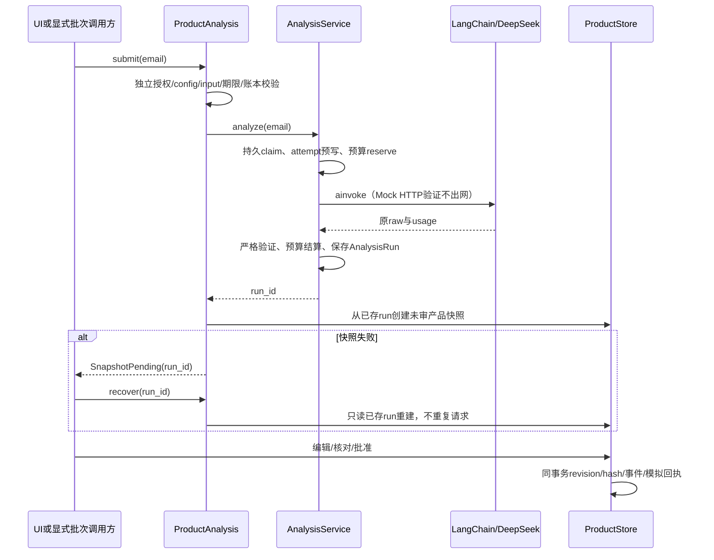

# 研究框架与课题需求追踪

课题：Research and Web Implementation of Customer Complaint Sentiment Analysis and Source Attribution System Based on Large Language Model and LangChain。

研究对象是合成客诉邮件的多问题结构化分析与可审核回复。可检验贡献为：版本化契约与来源证据、业务统计口径、模型错误和校验错误的分层追踪、人工审核和成本受控的工作流。不能将框架使用、测试数量或JSON合法作为模型语义改进证据。

## 方法、代码与文献关系

1=已有代码/实验支持；2=相似理念可作依据，非复现；3=尚未实施或尚无独立实验结论。

|方法|关系|实际实现与边界|可引用依据|
|---|---|---|---|
|实体/方面级情绪 ABSA|1+2|`analysis_v3.py` / `analysis_v31.py` 的Issue对象、类别与sentiment；与整体情绪分开。没有执行SemEval数据集或其官方评分|Pontiki等，2014，SemEval-2014 Task 4: Aspect Based Sentiment Analysis；阅读原文摘要和任务定义；餐厅/笔记本方面及极性，与本课题领域不同。[原文](https://aclanthology.org/S14-2004.pdf)|
|结构化抽取和分类|1|严格JSON、Pydantic、多字段一致性与原文跨度；`AnalysisService.validate_result`。实际生产适配采用JSON object模式及自有验证，未用LangChain自动语义判分|[LangChain ChatOpenAI官方文档](https://docs.langchain.com/oss/python/integrations/chat/openai)，2026-10-26读取，页面未给论文式发布日期；文档能力不等于本项目都采用|
|Evidence-grounded判断|1+2|原文start/end/quote校验、风险/紧急度/主次证据；逐字正确与语义支持分离。没有外部检索/RAG或ALCE评测|Gao等，EMNLP 2023（12月），Enabling Large Language Models to Generate Text with Citations；阅读摘要，ALCE评价检索生成引用的流畅性/正确性/引用质量。[来源](https://aclanthology.org/2023.emnlp-main.398/)|
|多维质量评价|1+2|七字段、结构、Issue、证据、风险、回复、成本独立报告；`e2e.py`、`e2e_v3.py`、历史report模块。人类评分多数仍null|Mitchell等，Model Cards for Model Reporting，预印本2018-10-05，v2 2019-01-14，FAT* 2019；阅读摘要，强调适用范围和分组评价，本项目只借鉴披露理念。[来源](https://arxiv.org/abs/1810.03993)|
|LLM-as-a-Judge及偏差控制|1有限/3正式协议|现有是开发助手候选审阅，未运行独立付费Judge；不替代Gold。位置交换、模型匿名、风格控制和人类校准为P5提案|Zheng等，Judging LLM-as-a-Judge with MT-Bench and Chatbot Arena，2023-06-09，v4 2023-12-24；阅读摘要，位置/冗长/自偏好和推理局限；其人类一致率不能转借项目。[来源](https://arxiv.org/abs/2306.05685)|
|多问题匹配与归因|1/3认证|`e2e_v3.align_issues` 是确定性贪心“共享精确证据跨度×10+对象相等”，非最优匹配；`compare_issues`另做严格签名比较。业务归属非因果/法律责任；P5人工匹配待执行|本项目算法与局限直接引用源码，不能声称复现某论文或已完成人类问题级准确率|
|人在回路|1/3独立标注|ProductStore审核/退回/版本/模拟发送可运行；gold.py双人声明与仲裁冻结可验证声明完整性，但不能验证真人身份或独立性|本项目状态机和P5协议；不把demo_test/勾选动作称为独立标注|
|版本实验与Champion–Challenger|1+2|P3.9/P3.10固定计划、父raw/纠错run及负结果保存；新40有预算不对等限制。失败候选不晋升|Gebru等，Datasheets for Datasets，预印本2018-03-23，v8 2021-12-01，CACM 2021年12月；阅读摘要，数据动机/构成/采集/用途披露。[来源](https://arxiv.org/abs/1803.09010)|

上述论文及官方页面于2026-10-26核对标题、摘要/原文、日期和适用范围。理论相似性不代表论文复现。项目没有训练自有基础模型，不主张模型卡论文证明了本项目的性能。

## Requirement Traceability Matrix

原始需求可靠来源：本轮用户粘贴任务的第6节是当前明确要求；历史 `docs/supervisor_report_summary_v1.md` / `docs/p4/THESIS_AND_P5.md` 仅为项目总结。仓库文件清单及eml/msg搜索未找到导师三封原始邮件，不能提供导师原话、邮件日期或批准结论。下表各行均遵循这一来源限制；最终由研究者对照原件确认。

|需求|当前实现|实际演示/证据|状态|还缺什么|
|---|---|---|---|---|
|LLM合成客户邮件|历史生成器是55模板程序；新40是开发代理编写的探索文本，没有独立批量生成请求账本|历史400内存复建与CSV一致；成绩单来源审计|未满足可追溯LLM生成要求|单独新数据版本、生成模型/Prompt/raw/usage、人工筛选与新授权；见PROTOCOL，不改旧400标签|
|门店、商品、表扬、投诉覆盖|历史400的11场景族，商品/门店字段、70表扬和多类投诉|Historical dashboards → Synthetic Reference Statistics；逐类计数见成绩单|演示覆盖满足；独立代表性部分满足|真实分布不可从模板推出；新数据按分层协议审核|
|LangChain情绪分析与来源归因|历史真实ChatOpenAI.ainvoke；v3/v3.1逐Issue；本轮ProductAnalysis→双SQLite→审核的Mock HTTP全链路|历史真实run重放对照attempt身份；tests/test_product_analysis.py实际SDK通路|工程部分满足，任意新邮件实时质量未认证|研究者选择正式profile、新预算与白名单；一次受控真实产品冒烟及独立质量实验|
|哪些商品负评最多|历史确定性聚合及P3版本隔离排名/成员追溯|Dashboard历史商品负面计数；P3选同版本与成员|合成演示满足|没有真实消费者市场排名结论；新P4汇总不是替代旧商品排名|
|哪些门店投诉最多|历史门店投诉计数/比例、P3版本来源统计|切换参考与真实历史预测模式；核对投诉数/全部合格邮件分母|合成演示满足|unknown/失败单列；多Issue口径须与邮件单位区分；不推断门店法律责任|
|自动生成邮件回复|真实历史suggested_reply；离线示例和新分析服务可创建未审草稿|单条→Issue/Evidence→编辑版本→批准→模拟；原模型错误不得发送|草稿能力满足；任意新邮件实时使用部分满足|独立人类事实/覆盖/能力边界评分。真实自动投递不在当前毕设演示边界，不冒称已发送|
|友好Web界面|保留Streamlit四Tab；中文核心标签、摘要优先、Developer Details、CSV局部错误、统计下钻|本轮实际浏览器证据与回归；研究者可直接体验|工程满足，体验需研究者验收|研究者确认任务可完成、解释无歧义；生产多用户/移动端不是本轮承诺|

## LangChain真实路径和模块边界

旧兼容链 `src/chains/langchain_complaint_chain.py` 用 `ChatPromptTemplate | llm`，含旧提取/标准化/fallback；当前P4不走它。`ProductFake` 用RunnableLambda返回编写fixture；不是推理。真实适配 `src/infrastructure/deepseek.py` 构造ChatOpenAI并ainvoke，保留usage/response metadata；项目自己的消息函数绑定版本。官方文档指出第三方非标准字段有兼容边界，项目仅对已测试的DeepSeek请求/返回字段作适配，不宣称任意provider兼容。

持久化不是分布式单事务；恢复以已保存终态run为准。运行中/未知发送拒绝建草稿；失败终态只建诊断案例。新真实调用仍默认禁用；Mock HTTP不代表实时DeepSeek已验收，P3.10失败Challenger未默认启用。
