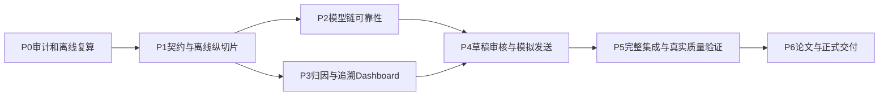

# Phased Roadmap：从可信基线到可审核业务闭环

批次2026-10-14，2026-10-15完成。路线更新于2026-10-15：**P1_ENGINEERING_VERIFIED**；P1已按批准的A方案实施，P2已于2026-10-15完成工程与真实小样本试点（见docs/p2/VERIFICATION.md）；P3–P6仍为PROPOSED。下方P0历史说明保留。

依据：[审计](../audit/2026-10-14-legacy-audit.md)、[架构选项](../architecture/2026-10-14-architecture-options.md)。优先级P1先解决评测/契约，再做产品纵切片；不以重写前端或引入技术栈作为阶段完成标准。

## 1. 阶段依赖与范围调整

保留用户建议的七阶段，但将评测器高优先级修复、最小应用服务与存储试点前移到P1，因为当前“评测成功”和“Schema成功”本身不可信；否则P2模型改进没有稳定度量。P3可在P1后用fake/历史只读结果推进，不必等待付费调用。Unit/Integration从P1开始，不推迟到P5；P5负责整体验证和缺口收敛。论文边界记录贯穿各阶段，不等到P6才补造实验记录。

当前基线：494/560=88.21%是80条历史七字段结果；32/80=40%是同批七字段全对邮件率；400/400只支持历史标记一致性和批次稳定性线索。后续不承诺虚构的提升目标，不用事后92.14%替换raw基线。

## 2. P0：恢复与审计（本轮）

| 项目 | 内容 |
|---|---|
| 用户/研究目标 | 恢复实际能力、实验可信边界和可执行设计 |
| 前置/依赖 | 只读仓库与本地依赖；禁止模型调用和历史写入 |
| 新增/修改模块 | 仅审计/架构/路线/HANDOFF/AGENTS及文档目录的证据与重放工具 |
| 保留能力 | 所有现有源码、数据、Gold、历史outputs、论文资产 |
| 技术决定/替代 | 现有venv + 无网络副本；无锁，不重新解析依赖；不能运行的路径改静态检查 |
| 验证 | 77源码编译、46JSON、34资产脚本、18mock、80指标、14聚合表、AppTest/fake、hash保护 |
| 完成标准 | 必需文档齐全且结论有路径/证据；本轮未覆盖项明确；起始401资产hash不变 |
| 论文贡献 | 修正LLM生成数据主张、88.21%含义、Gold来源和批量稳定性解释 |
| 风险/不做 | 真实API、独立盲标、浏览器E2E、Word页面质量仍待验证；不改功能、不提交Git |

状态AUDIT_PARTIAL的原因是验证范围有限，P0文档交付不依赖先做P2付费验证。

## 3. P1：契约、可信评测与第一条离线纵切片（已验收）

实际完成：七字段共享评测核心与六字段兼容、F01–F06回归、canonical v2、offline fake/legacy adapter、无UI依赖的应用服务、SQLite四表/事务/幂等、真实app.py单条保存/重读/过滤/聚合下钻。初始失败证据、最终测试与资产清单见 [P1 VERIFICATION](../p1/VERIFICATION.md)，操作见 [REPRODUCE](../p1/REPRODUCE.md)。未调用模型、未发送邮件、未Git发布。

下表保留原计划及验收依据；其中“待确认”项已由本轮用户授权解决。未创建CI/依赖锁，当前可重放入口为标准unittest离线runner；CI/安装环境固定仍留给P5。本轮只使用AppTest，不称浏览器E2E。

| 项目 | 内容 |
|---|---|
| 用户/研究目标 | 从实际Single Analysis入口获得可保存、可重读、可追溯的结果；让评测器不伪计分 |
| 前置/依赖 | 阅读审计/HANDOFF；人工确认A方案、SQLite试点、canonical taxonomy/unknown/单主问题语义；若未决先写纯离线缺陷回归，不擅定Gold新含义 |
| 新增/修改模块 | contracts/taxonomy、analysis_service、Analyzer/Repository接口、fake/legacy适配、SQLite候选实现；统一evaluation核心；最小app接线和缺失指标展示修复；tests及最小CI配置 |
| 保留能力 | 4个tab、legacy mock基线、三个历史Dashboard模式、CSV导出、80/400历史只读复核 |
| 技术决定/替代 | Streamlit保留；普通Python service；SQLite经确认才实施，替代为新run目录JSON/CSV但须显式约束；无FastAPI/React/队列 |
| Unit/Contract | 缺预测/缺Gold字段、重复/空ID、不完整覆盖、extra ID、非法bool/enum、空对象/数组、noncomplaint冲突；合法对象与legacy adapter兼容 |
| Integration/UI验收 | fake→service→临时存储→关闭/重开查询→详情→统计成员原文；AppTest单条、错误、刷新和缺报告；同键重复不创建重复成功run |
| 量化完成标准 | F01–F06各有可失败回归并修复通过；历史80重算仍494/560、66 mismatch；新run的原文/输入hash/版本/backend可读取；缺报告时0个伪造成绩；冻结资产hash零变化 |
| 论文贡献 | 可复现方法与数据契约；说明旧指标与新规范之间的兼容边界 |
| 风险/不做 | 严格校验使旧宽松输出显式失败是预期；不借机调Prompt/改Gold/覆盖400；不实现真实发送或完整多标签 |

P1首次冻结的是可审定的契约和测试基线，不是提前把所有未来表/接口写成空Spec。

## 4. P2：结构化输出与模型调用可靠性

2026-10-15状态更新：P2_ENGINEERING_VERIFIED / REAL_MODEL_PILOT_VERIFIED。77项离线通过，12封/12次真实请求；详细指标、限制与未实施的P3建议见[本轮验证](../p2/VERIFICATION.md)。下表保留原规划，不代表所有未来生产能力已验收。

| 项目 | 内容 |
|---|---|
| 用户/研究目标 | 把合法格式、完整字段、业务一致性与真实模型语义分开观测；失败可解释 |
| 前置/依赖 | P1契约/版本/临时存储与fake回归；真实调用另需模型/数据/最大尝试/费用授权 |
| 新增/修改模块 | DeepSeek provider adapter、版本化Prompt/schema、strict parser、normalizer、semantic validators、attempt日志、batch/run resume策略 |
| 保留能力 | 旧LangChain链作为版本基线与legacy wrapper，mock为显式fallback；保留历史raw指标 |
| 技术决定/替代 | 优先现有ChatOpenAI兼容接口；provider专用包仅在contract与小样本对比证明收益后换；超时/总预算显式，JSON修复与HTTP重试分别记录 |
| Unit/Integration | fake注入空响应、截断、数组、schema错、429/5xx/超时/认证错；验证重试次数上限、不可重试错误、无静默fallback混算、版本变化不复用旧结果 |
| 量化完成标准 | 列出的错误路径全部有断言；所有attempt有状态与耗时；原始/normalized状态分开；混后端不能accepted；真实小样本结果及失败/Token缺失如实入账，未授权时真实门槛保持pending |
| 论文贡献 | 结构化输出可靠性实验、错误分类、prompt/schema/model版本和成本可复现方法 |
| 风险/不做 | 模型alias漂移；不存在“JSON100%即语义100%”；不把原80同时作为调参集与新独立测试；不引入LangGraph/RAG |

真实模型语义提升阈值在独立开发/测试划分后预注册；当前只冻结正确测量的方法，不先许诺95%等目标。

开发集、验证集和新holdout在Prompt调参前按生成模板/来源分组划分，至少检查`generation_template_id`及近重复正文；只做随机邮件ID切分不足以避免同模板污染。保存集合ID与hash、冻结日期和访问/调整记录；新holdout不参与Prompt与normalization规则选择，报告抽样方法及合成分布限制。

## 5. P3：Source Attribution 与可追溯Dashboard

| 项目 | 内容 |
|---|---|
| 用户/研究目标 | 用户能解释某门店/产品负面比例的分母，并从统计回到每封来源邮件 |
| 前置/依赖 | P1 run/result保存和canonical语义；历史数据导入标记为historical_import；fake可完全推进 |
| 新增/修改模块 | attribution_service、共享deterministic aggregate、按run/filter查询、详情下钻、store/product alias适配与unknown桶、Dashboard展示 |
| 保留能力 | 原I4F/I5C参考/预测分离、原始分母口径与20条demo资产；旧文件只读 |
| 技术决定/替代 | Python/SQL确定性计数；邮件为默认分母单位；如新增issue统计另命名。无因果归因模型 |
| Unit/Integration | 纯合成fixture校验count/rate、none/unknown、别名、重复、零分母、failed/fallback过滤；聚合→member IDs→原文一致性 |
| 量化完成标准 | 既有14表复算不变；新Dashboard每个统计携带numerator/denominator/run版本；所有返回成员ID可读取原文，成员数与分子一致；筛选/刷新结果一致 |
| 论文贡献 | 明确业务归属、投诉计数、负面占比、原因类别和因果解释的不同层级 |
| 风险/不做 | 旧门店自由文本映射须审定，不回写Gold；合成均衡分布不作真实经营排名；不加向量库 |

## 6. P4：回复草稿、人机审核和模拟发送

| 项目 | 内容 |
|---|---|
| 用户/研究目标 | suggested_reply成为可修订草稿，审核通过后才可模拟发送，完整留痕 |
| 前置/依赖 | P2可靠状态与事实来源；P3邮件/结果详情；人工确认角色与政策边界 |
| 新增/修改模块 | reply_service、review_service、Draft/Review/SimulatedSend契约、UI编辑/审核/模拟状态、事件存储 |
| 保留能力 | 现有回复建议和legacy输出仍可查看；预测/人工修正/Gold分离 |
| 技术决定/替代 | 简单显式状态机和数据库事务；只有持久复杂分支证明必要时评估LangGraph；发送适配器仅fake |
| Unit/Integration/E2E | 未审核不能模拟发送；编辑后旧审批失效；重复操作幂等；不同草稿版本/并发审核冲突；订单/退款承诺注入fixture与人工rubric |
| 量化完成标准 | 每次修改/审核/模拟事件可查询；所有发送记录绑定approved draft版本；未审核及过期审批0次成功模拟；重复幂等键只有1次模拟事件；无真实邮件适配器调用 |
| 论文贡献 | 人工控制、责任边界、回复事实一致性及系统闭环演示 |
| 风险/不做 | Prompt安全不等于回复政策合规；不连接SMTP/客户邮箱，不自动承诺退款，不引入多Agent审批 |

## 7. P5：工程化、集成与质量验证

| 项目 | 内容 |
|---|---|
| 用户/研究目标 | 交付能安装、运行、重放并报告质量/失败/成本的系统 |
| 前置/依赖 | P1–P4离线路径完成；独立holdout与标注流程确认；真实评测明确授权预算；真实客户数据另审 |
| 新增/修改模块 | 正式测试套件、安装/运行说明、依赖锁定方案、离线CI、browser E2E、性能采集、独立评测runner与run manifest |
| 保留能力 | 历史结果/参考集和全部兼容演示；现有validate脚本作为辅助资产验证 |
| 技术决定/替代 | 首先单进程/单机实际测量；达到明确部署门槛再用ADR引入FastAPI、PostgreSQL或worker；不是预设全栈升级 |
| 测试设计 | Unit/Contract/Integration全跑；fake浏览器导入→分析→下钻→草稿→审核→模拟发送；真实模型单独任务；负载测试包括故障/恢复，不仅平均耗时 |
| 量化完成标准 | 全部已定义离线测试通过；冻结80可复算、Gold/历史hash不变；独立holdout报告样本/字段/coverage、raw及normalized指标、失败率；每次真实尝试有延迟/usage或明确缺失，报告p50/p95、吞吐和实际成本依据 |
| 论文贡献 | 可复现实验协议、ablation/基线对比和工程质量证据，研究泛化限制透明 |
| 风险/不做 | 未授权真实评测时只能交付离线工程门槛，不冒充真实模型验证；不为跑通CI自动付费或上传LangSmith |

依赖锁在P5前根据P1安装复验需要可前移，但必须作为单独明确变更；本轮没有锁文件可复用，不直接升级后重新生成锁来“修复审计”。

## 8. P6：论文实验、开源与正式交付

| 项目 | 内容 |
|---|---|
| 用户/研究目标 | 论文声明与代码/数据/实验完全对应，形成可供导师和后续工程师检查的版本 |
| 前置/依赖 | P5真实结果及限制齐全；导师确认研究边界；开源许可、数据/图片和个人信息审查 |
| 新增/修改模块 | 论文最终文本/图表、实验复现说明、LICENSE候选与发布检查；HANDOFF更新 |
| 保留能力 | 原稿及历史实验不覆盖；生成新最终版本保留来源 |
| 技术决定/替代 | 模板数据与LLM数据分别标来源；确定性统计图用固定输入；学校Word模板单独迁移，不用README声明代替证据 |
| 测试/验收 | 文中所有数字回溯run+hash；引用核验；DOCX逐页渲染检查；浏览器答辩流程；秘密扫描及历史资产校验 |
| 量化完成标准 | 核心论文数字100%有来源索引；0个把400当人工准确率、把88.21%当邮件全对率或把模板生成写成已验证LLM生成的声明；最终文档无未确认占位项；发布前所有门槛有记录 |
| 论文贡献 | 最终研究论证与限制、答辩证据、可复现材料包 |
| 风险/不做 | 不补造过去标注/请求/成本日志；无授权不commit/push/tag/release；截图不是完整E2E证据 |

## 9. 首条 Vertical Slice（P1具体施工入口）

入口使用真实 `app.py` 的 **Single Analysis**。用户提供一封明确标为synthetic的fixture（正文、subject和稳定ID），选择 **offline fake**；UI调用 `AnalysisService`，service验证输入/版本/幂等键，调用fake或legacy adapter，严格校验结果，将原文、run、结果保存到新的临时SQLite（经架构确认）。页面返回run_id和详情；刷新/重开后按run_id重读；查看门店负面计数1/该门店全部邮件数，并点击成员邮件回到同一原文。首条纵切片到此结束，不提前实现P4全部审批。

采用可核验fixture：A门店一封negative complaint、一封positive，B门店一封neutral，另有unknown门店；确定性预期由测试fixture显式给出，不由待测模型生成Gold。先通过A门店1/2=50%的分母检查，再验证unknown与失败行的独立口径。

验收断言：同键双击不会重复写成功run；更换Prompt/输入版本产生新run；空正文拒绝；fake失败显示明确状态且不进入成功统计；重读字节/内容hash一致；返回成员ID正好对应分子邮件；跨rerun页面保留结果；缺历史报告不显示默认成绩；原80/400资产hash不变。批量上传和完整浏览器E2E在P3/P5扩展，不能把此切片函数测试称为全产品E2E。

## 10. 离线与真实模型验证边界

| 完全离线可验证 | 必须真实模型/其他外部证据 |
|---|---|
| Schema/语义规则、ID对齐、指标公式、历史重算、存储事务/恢复/幂等、统计分母/追溯、审核状态和模拟发送 | 当前DeepSeek账号/API兼容、实际模型结构化输出稳定性、情绪/归因语义、Prompt注入抵抗、真实回复质量 |
| fake超时/429/认证/截断注入下的应用控制流、UI错误与刷新、确定性存储负载 | 实际网络超时/限流、真实p50/p95、provider成本/Token以及后端模型alias漂移 |
| assisted Gold文件状态、改动hash和来源检查 | 独立人工标注真实性、双人一致性、未接触holdout保障需要真实review流程 |

离线测试通过不能替代右列；未获授权时保留pending并继续左列工作。

## 11. 下一轮Implementation Prompt输入

建议标题：**P1 — Freeze Contracts, Repair Evaluation, and Deliver an Offline Traceable Single-Email Slice**。

必须带入：分支main无HEAD、历史文件均未跟踪；审计F01–F08及401资产清单；明确选择A/存储/taxonomy；允许修改的源码清单和不覆盖历史资产规则；现有18/80/400基线；上述纵切片和边界测试；禁止真实API、真实发送和Git发布；最终报告源文件变更、测试命令、hash保护与仍待验证项。

先做F01/F02评测器回归与F05缺报告行为；再按已批准契约完成service/repository切片。F03/F04/F06的跨模块语义改动按P1契约落地，不能仅修展示而保留“成功”误报。若架构/业务语义未获确认，下一轮先完成无需语义改变的回归设计与具体设计供审，不擅自实施重大变更。
